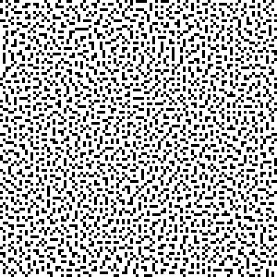
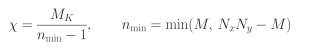
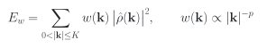
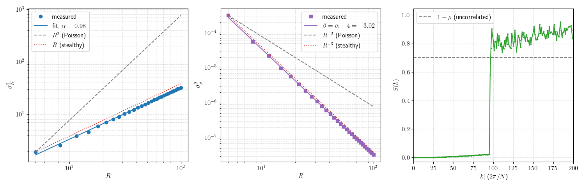
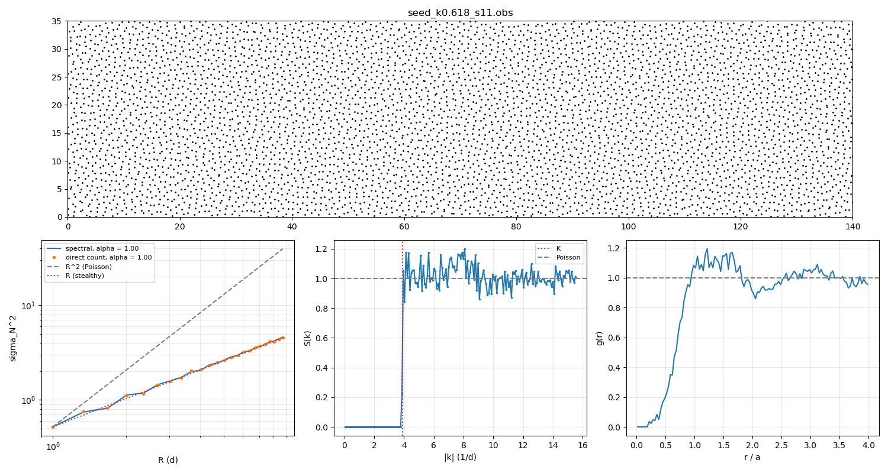
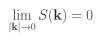
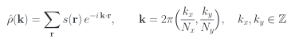
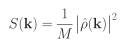
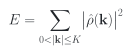

# Hyperuniform2D

**Version 2.1.0** — see [CHANGELOG.md](CHANGELOG.md).

Generator for hyperuniform points in a 2D square grid

This repository contains a C++20 program that generates **stealthy hyperuniform binary patterns** on a periodic *N*<sub>*x*</sub> × *N*<sub>*y*</sub> lattice (square or rectangular). The patterns are obtained by **Metropolis simulated annealing** of an energy built from the structure factor *S*(**k**). A **continuum mode** generates point patterns with real coordinates by L-BFGS minimization of the same energy, and both modes can write the obstacle files of hyperGalton2D.

The output is a configuration of occupied and empty sites that suppresses large-scale density fluctuations. That is the defining property of disordered systems with hidden order, relevant in photonics, granular materials and biology.

<p align="center">
  &nbsp;&nbsp;
</p>
<p align="center"><em>Left: the 400 × 400 pattern produced by the example <code>params.in</code> (density 0.3, χ = 0.3, <code>weight_power: 2</code>); occupied sites in black. Right: its top-left 100 × 100 corner, enlarged.</em></p>

## Requirements

- A **C++20** compiler (e.g. GCC 11+, Clang 14+, MSVC 19.29+)
- **CMake** 3.20 or newer
- For the analysis script: Python 3 with NumPy and Matplotlib (LaTeX is used for the labels if it is installed)

## Compilation

Compile in `Release` mode for full speed:

```bash
cmake -S . -B build -DCMAKE_BUILD_TYPE=Release
cmake --build build --parallel
```

Unit tests:

```bash
ctest --test-dir build --output-on-failure
```

They cover:
- the energy against a direct trigonometric evaluation;
- incremental updates and weighted energies;
- the thread pool and threaded determinism;
- χ selection;
- the Parseval sum rule of *S*(*k*);
- parameter parsing.

On a cluster, `-march=native` optimizes for the CPU of the machine that compiles. Either compile on a compute node or configure with `-DHYPER2D_NATIVE=OFF`.

## Quick start

The repository's `params.in` is a complete, commented example: a 400 × 400 lattice, density 0.3, χ = 0.3, with the long wavelengths weighted.

```bash
./build/hyper2D params.in                          # writes hyperuniform.pgm, annealing.dat, sk.dat
python3 scripts/test_hyper2D.py hyperuniform.pgm   # hyperuniformity check
```

The program takes one optional argument, the parameter file (default `params.in`). `hyper2D --version` prints the version.

The run makes about 14 million swap proposals and takes about 3 minutes on a Ryzen 5 5600X with 4 threads. The end of its output reads:

```text
Mask: K = 95.7183 (K² = 9162), chi = 0.299923 (target 0.3)
Initialized thread pool with 4 threads.
Automatic T_initial = 1.26998e+06
Starting simulated annealing → 'annealing.dat'
Annealing finished: 689 levels, 14180000 proposals, acceptance 0.2021. Monitoring saved to 'annealing.dat'
Initial energy: 9.65689e+08
Weighted energy (w ∝ |k|^-2): 9.10471e+08 -> 3.50694e+06
Final energy: 1.70076e+07, max incremental drift 3.44e-05
Residual <S>_mask / (1 - rho) = 0.01758 (1 = random start, 0 = perfectly stealthy)
Residual of the longest wavelengths, |k| <= K/4 = 23.93: 0.001085
Configuration saved to 'hyperuniform.pgm'
Structure factor saved to 'sk.dat'
```

The residual 0.018 means that *S*(**k**) inside the mask is 1.8 % of its value for an uncorrelated pattern. For the longest wavelengths it is 0.1 %. Both quantities are explained below.

### The example parameter file

```yaml
# hyper2D 2.x parameter file: "key: value", '#' starts a comment.
# Run:      ./build/hyper2D params.in
# Analyse:  python3 scripts/test_hyper2D.py hyperuniform.pgm
#
# Stealthy hyperuniform pattern on a 400 x 400 periodic lattice, density 0.3, chi = 0.3,
# with the long wavelengths weighted (weight_power: 2). Measured with these values (Ryzen 5 5600X):
# about 14 million proposals, a few minutes with 4 threads; residual <S>_mask/(1-rho) ~ 0.018,
# residual for |k| <= K/4 ~ 0.001, number-variance exponent alpha ~ 0.98.

# --- System ---------------------------------------------------------------------------------
# Lattice side (N x N sites, periodic)
N: 400
# Fraction of occupied sites; the number of occupied sites is round(density * N^2)
density: 0.3

# --- Mask (constrained wave vectors) --------------------------------------------------------
# Stealthiness chi = (constrained half-plane modes) / (n - 1), n = min(occupied, empty).
# chi > 0 derives the mask radius K from it (chi < 0.5 for disordered stealthy patterns).
chi: 0.3
# Mask radius in units of 2pi/N, used instead of chi when chi = 0 (uncomment and set chi: 0)
# K: 4.0

# --- Annealing energy -----------------------------------------------------------------------
# Mode weights w(k) ~ |k|^(-weight_power): 0 = standard unweighted energy; 2 keeps the residual
# away from the longest wavelengths, which control the number variance at large R (recommended)
weight_power: 2

# --- Cooling schedule -----------------------------------------------------------------------
# Initial temperature; <= 0 = automatic (a typical uphill swap is accepted with probability 1/2)
T_initial: 0
# Final temperature: the annealing stops below it
T_final: 0.001
# Geometric cooling factor per temperature level
cooling_rate: 0.97
# Swap proposals (occupied <-> empty) per temperature level
steps_per_temp: 20000
# Fraction of proposals that move a point to a nearby empty site, and "nearby" (Chebyshev distance)
local_fraction: 0.5
local_radius: 1
# Zero-temperature proposals after the annealing (only downhill swaps)
quench_steps: 400000
# Stop as soon as the (weighted) energy is below this value
energy_tol: 1e-6

# --- Run ------------------------------------------------------------------------------------
# Random seed (0 ... 2^32 - 1)
seed: 1729
# Threads: 0 = automatic (min(4, CPUs available to the process)), 1 = sequential
num_threads: 0

# --- Output files ---------------------------------------------------------------------------
# Pattern (plain PGM, 1 = occupied; the header comments record the parameters and residuals)
output_file: hyperuniform.pgm
# Per temperature level: T, energy, cumulative and per-level acceptance
annealing_file: annealing.dat
# Radially averaged structure factor S(k) = |rho_hat(k)|^2 / M
sk_file: sk.dat
```

A value that cannot be parsed, or one out of range, stops the program with a message that names the line. All the keys are listed in [Parameter file](#parameter-file).

## Stealthiness χ

The number of constrained wave vectors is measured by a **stealthiness** parameter in the spirit of Torquato and coworkers (Batten, Stillinger & Torquato 2008; Zhang, Stillinger & Torquato 2015). On the lattice the program uses the **`binary_lattice` convention**:

<p align="center"></p>

- *M*<sub>*K*</sub> is the number of constrained wave vectors with 0 < |**k**| ≤ *K*. Because ρ̂(−**k**) = ρ̂(**k**)\*, each ±**k** pair counts once, so *M*<sub>*K*</sub> is the number of half-plane modes in the mask.
- *n*<sub>min</sub> is the minority species. On the lattice, the empty sites have the same |ρ̂(**k**)| as the occupied ones for every nonzero **k**.
- χ is the ratio of independent real constraints (2*M*<sub>*K*</sub>, a real and an imaginary part per pair) to real degrees of freedom (2(*n*<sub>min</sub> − 1)).

This is **not** the χ of point patterns, χ<sub>point</sub> = *M*<sub>*K*</sub> / [2(*N* − 1)] for *N* points in two dimensions. That one is used in the continuum literature and in the obstacle file format of hyperGalton2D (`chi_convention: point_pattern`). For density < 1/2 and the same mask, the lattice χ is about twice χ<sub>point</sub>. Versions up to 2.1.0 displayed the equation of this section as *M*<sub>*K*</sub>/[2(*n* − 1)], but the program has always computed *M*<sub>*K*</sub>/(*n* − 1); only the documentation was wrong.

The program prints both values and the dimensionless mask radius κ = *K a* / 2π, where *a* = (*N*<sub>*x*</sub>*N*<sub>*y*</sub>/*M*)<sup>1/2</sup> is the mean spacing of the occupied sites. κ does not depend on the box shape or on the convention, so patterns from different generators are compared at equal κ (or equal *K*), never at equal χ. Counting modes by area gives χ<sub>point</sub> ≈ πκ²/4.

The disordered regime of the continuum, χ<sub>point</sub> < 1/2, has no exact counterpart on the lattice. There the annealing leaves a residual that grows quickly with *K*: see [Residual on the lattice](#residual-on-the-lattice). The program warns when χ<sub>point</sub> > 1/2 and when the lattice χ > 1/2.

The mask can be set in three ways; if more than one is given, `kappa` wins over `chi`, and `chi` over `K`:

- `kappa > 0`: *K* = κ √*M* in units of 2π/√(*N*<sub>*x*</sub>*N*<sub>*y*</sub>).
- `chi > 0`: the shell whose lattice χ is closest to the target. All the modes of a shell (same |**k**|) enter together, so the achieved χ is discrete; it is printed and recorded in the PGM header.
- `K`, in units of 2π/*N*: only for square lattices, as in version 2.x.

On a lattice the annealing does not reach *E* = 0. The program therefore reports the residual ⟨*S*⟩<sub>mask</sub> / (1 − ρ): 1 for the random start, 0 for a perfectly stealthy pattern. It is typically 1–2 % at a lattice χ = 0.3.

### Residual on the lattice

Measured on a 128 × 128 lattice, density 0.3, `weight_power: 2`, automatic *T*<sub>initial</sub>, `T_final: 0.001`, `local_fraction: 0.5`, `quench_steps: 400000`, one seed. The point-pattern χ is that of the continuum pattern with the same κ.

| Lattice χ | χ<sub>point</sub> | κ | Residual, `cooling_rate: 0.9`, 3 000 steps | `0.97`, 20 000 steps | `0.99`, 60 000 steps |
|---|---|---|---|---|---|
| 0.2 | 0.10 | 0.36 | 0.0084 | 0.0065 | — |
| 0.6 | 0.30 | 0.62 | 0.078 | 0.064 | 0.054 |
| 0.9 | 0.45 | 0.76 | 0.16 | 0.133 | 0.119 |

The three schedules make about 0.55, 12.8 and 113 million proposals. Two hundred times more proposals lower the residual by only about 30 %. On the lattice, a pattern at the K of the continuum values χ<sub>point</sub> = 0.3 and 0.45 stays far from stealthy at this density.

The residual is set by the **occupation density ρ**, not by the schedule. At fixed κ = 0.618 (χ<sub>point</sub> = 0.3), about 4 900 occupied sites and the `0.97` schedule, it is close to 0.2 ρ:

| ρ | Lattice | Mean spacing *a* (sites) | Residual | Residual, `min_distance` = 0.4 *a* |
|---|---|---|---|---|
| 0.30 | 128 × 128 | 1.83 | 0.066 | — |
| 0.15 | 181 × 181 | 2.58 | 0.030 | — |
| 0.08 | 248 × 248 | 3.54 | 0.016 | — |
| 0.04 | 350 × 350 | 5.00 | 0.0076 | 0.0079 |
| 0.02 | 495 × 495 | 7.07 | 0.0040 | 0.0039 (second seed: 0.0038) |
| 0.01 | 700 × 700 | 10.0 | — | 0.0019 |

The cost per proposal depends on the number of modes, which is fixed by κ and the number of occupied sites, so every run took about 2 minutes. A finer lattice brings the pattern closer to the continuum. Rounding a point pattern to a lattice of spacing *a*<sub>lattice</sub> gives *S* ≈ (*K a*<sub>lattice</sub>)²/12 ∝ κ²ρ at the edge of the mask, and the annealing removes most of it.

At χ<sub>point</sub> = 0.45 (κ = 0.757, lattice χ 0.90) the residual is about three times larger: 0.0113 at ρ = 0.02 and 0.0064 at ρ = 0.01 (`min_distance` = 0.4 *a*, α = 0.95–0.99). There the pattern keeps by itself a minimum distance of 0.58–0.67 *a*, so the exclusion is not active.

For a lattice control of the continuum patterns, use a fine lattice, ρ ≤ 0.02, with `R` (or `min_distance`) set. The residual accepted for the hyperGalton2D campaign is 0.011, so ρ = 0.02 covers its three χ values (0.004 at χ<sub>point</sub> = 0.3, 0.011 at χ<sub>point</sub> = 0.45).

Without exclusion, the closest pairs are at one lattice spacing: on a fine lattice a few pairs (1.6 % of the points at ρ = 0.02) sit on neighbouring sites. `min_distance` forbids that. Up to 0.5 *a* it does not change the residual.

## Weighting the long wavelengths (`weight_power`)

That residual is not uniform.
- **Few modes.** All modes weigh the same in *E*, and the lowest |**k**| are a small fraction of them.
- **Local moves barely touch them.** Moving a point a distance δ changes ρ̂(**k**) by an amount proportional to |**k**·**δ**|.

The annealing therefore leaves most of the residual at the longest wavelengths. Those are the modes that control the number variance at large *R*: a residual *S*<sub>0</sub> adds about ρ *S*<sub>0</sub> π *R*² to σ<sub>*N*</sub>², and the fitted exponent drifts towards 2. The effect grows with *N*.

With `weight_power: p` the annealing minimises

<p align="center"></p>

- **Normalisation.** The weights have mean 1 over the mask, so the temperature scale is unchanged.
- **Same target.** All weights are positive, so *E*<sub>*w*</sub> = 0 exactly when *E* = 0: the target, perfectly stealthy patterns, is the same. Only the unavoidable residual is pushed towards large |**k**|, where it hardly affects σ<sub>*N*</sub>².
- **Reported values.** The program prints the unweighted *E*, the mask average of the residual, and the residual of the longest wavelengths, |**k**| ≤ *K*/4.

Measured with ρ = 0.3, χ = 0.3, automatic initial temperature and the same schedule for each *N*:

| N | p | residual, mask | residual, \|k\| ≤ K/4 | α (5 ≤ R ≤ N/4) |
|---|---|---|---|---|
| 120 | 0 | 0.017–0.018 | 0.024–0.034 | 1.23–1.57 |
| 120 | 1 | 0.015 | 0.005–0.006 | 1.04 |
| 120 | **2** | 0.017 | 0.0009–0.0013 | **0.97–0.98** |
| 120 | 3 | 0.027 | 0.0002–0.0004 | 0.98–0.99 |
| 400 | 0 | 0.018 | 0.037 | 1.69 |
| 400 | **2** | 0.018 | 0.0011 | **0.98** |

The *N* = 120 rows cover two seeds. `weight_power: 2` is recommended. With p = 3 the low-k modes are even cleaner, but the mask average gets worse. The default, 0, is the standard unweighted energy.

## Multithreading

A thread pool splits the modes of each swap proposal among threads. The calling thread does one share, and the pool synchronizes with spinning barriers. A proposal lasts only microseconds, so the futex wake-up of `std::barrier` (tens of µs) cost more than the work it parallelized.

- `num_threads: 0` uses min(4, CPUs this process may run on). The CPU count comes from the affinity mask, i.e. the Slurm allocation, not every core of the node.
- `num_threads: 1` runs sequentially.
- With fewer than `parallel_min_modes` half-plane modes (default 2000), the program runs sequentially anyway.

Spinning keeps every pool thread busy for the whole run, so never request more threads than allocated cores. To produce many maps, one sequential process per map (e.g. a Slurm array) is more efficient than threading a single map.

Measured on a Ryzen 5 5600X (6 cores, 12 hardware threads), in µs per proposal at low acceptance:

| N | half-plane modes | 1 thread | 2 | 4 | 8 |
|---|---|---|---|---|---|
| 120 | 1 728 | 2.0 | 2.4 | 1.5 | 1.6 |
| 240 | 6 912 | 17 | 8.4 | 5.7 | 4.5 |
| 400 | 19 196 | 57 | 21 | 17 | 21 |

## Output files

The file names are set in the parameter file.

1. **`hyperuniform.pgm`**: the final configuration as a plain-text PGM image (P2), with 1 = occupied and 0 = empty, *N*<sub>*x*</sub> pixels wide and *N*<sub>*y*</sub> high.
   - Comment lines after the magic number record the version, *N*, density, *K*, χ (achieved and target), seed, energies, residuals and `weight_power`. On a rectangular lattice they also record *N*<sub>*x*</sub>, *N*<sub>*y*</sub>, κ and χ in both conventions. PGM readers skip them.
   - Image viewers show the occupied sites in white. To draw them in black, invert the image: `magick input.pgm -negate -compress none output.pgm`. The analysis script still recognises the occupied sites of an inverted file, from the count recorded in the header.
2. **`annealing.dat`**: one line per temperature level, with temperature `T`, energy (`E`, or `E_w` with weights), cumulative acceptance rate `acc/rate` and the acceptance rate of that level `acc/level`. Every proposal is a genuine occupied ↔ empty swap. Use it to tune the cooling schedule.
3. **`sk.dat`**: radially averaged structure factor *S*(*k*) = |ρ̂(**k**)|² / *M* over the whole Brillouin zone (all nonzero **k**, bins of width 1 in units of 2π/√(*N*<sub>*x*</sub>*N*<sub>*y*</sub>), i.e. 2π/*N* on a square lattice).
   - Columns: mean |*k*| of the bin, *S*(*k*) and number of modes.
   - For an uncorrelated lattice gas, *S* = 1 − ρ.
4. **`.obs` and `.sk`** (with `obs_file`): the obstacle file of hyperGalton2D and its structure-factor companion; see [Obstacle files](#obstacle-files-for-hypergalton2d).

With `realizations` > 1, every output name gets `_arrNNN` before its extension.

## Obstacle files for hyperGalton2D

With `obs_file`, the program also writes the pattern in the obstacle file format of hyperGalton2D, version 1 (`docs/formats/obstacles-format.pdf` in that project). Lengths are in grain diameters, *d* = 1. The occupied site (*i*, *j*) becomes an obstacle at (*i a*, *j a*), with *a* = `lattice_constant`.

- **Header.** Every required key and, for `class: stealthy`, the diagnostics:
  - `K` in *d*⁻¹ with the 2π included, written halfway between the outermost shell of the mask and the next one, so that a reader that rebuilds the circle |**k**| ≤ *K* from `K`, `Lx` and `Ly` gets the same modes;
  - `n_constrained_modes`, *M*(*K*) in a half space;
  - `chi_convention: binary_lattice` and `chi`;
  - `kappa`, `residual_S` (⟨*S*⟩<sub>mask</sub>/(1 − ρ)) and `lattice_constant`.
- **Values derived from the body.** `n_obstacles`, `rho_O`, `d_min` (minimum image in x only for `periodic_x`), `kappa` and `sha256_body` are computed from the numbers exactly as written. Every real is written with the shortest representation that reads back as the same double, and the body is ordered by *y*, then *x*. The body is reproducible byte for byte; only `created` changes from day to day.
- **No overlaps.** `R` implies a hard-core exclusion of 2*R*/*a* (slightly more, so that rounding cannot break it), so the file always satisfies *d*<sub>min</sub> ≥ 2*R*.
- **Physical box.** With `Lx`, `Ly` and `rho_O` the program derives the lattice from the occupation fraction `density`: *a* = *L*<sub>*x*</sub>/*N*<sub>*x*</sub> with *N*<sub>*x*</sub> = round(*L*<sub>*x*</sub>/√(`density`/ρ<sub>O</sub>)), so *L*<sub>*x*</sub> is exact. *L*<sub>*y*</sub> is the closest multiple of *a*, and the occupation is set so that the obstacle density stays ρ<sub>O</sub>.
- **File name.** `obs_file: auto` uses the recommended name `stealthy_rho<ρ>_Lx<Lx>_Ly<Ly>_arr<NNN>.obs`. `arr_index` and `realizations` number a series with consecutive seeds.
- **Companion.** `<name>.sk` has the radially averaged *S*(*k*), *k* in *d*⁻¹, with the `sha256_body` of its `.obs`.

A lattice control at χ<sub>point</sub> = 0.3 for a box of 160 × 40 *d* at ρ<sub>O</sub> = 0.2 (see [Residual on the lattice](#residual-on-the-lattice) for the occupation):

```
Lx: 160
Ly: 40
rho_O: 0.2
density: 0.02
R: 0.2
kappa: 0.618
weight_power: 2
boundary: periodic_x
obs_file: auto
realizations: 100
```

`scripts/obs_tools.py` checks and views the files:

```bash
python3 scripts/obs_tools.py validate stealthy_*.obs
```

```bash
python3 scripts/obs_tools.py topgm stealthy_rho0.199991_Lx160_Ly40.1581_arr000.obs --px-per-d 10 --y-up
```

- `validate` applies the eight rules of a version-1 reader, plus the file conventions, the keys required for `class: stealthy`, the mask (the circle |**k**| ≤ *K* must hold `n_constrained_modes` modes), `kappa`, `chi`, and the free-gap warning. The exit code is 1 if any file fails.
- `topgm` writes a PGM. In mode `lattice` it gives one pixel per site, identical to the PGM of hyper2D; with `--px-per-d` it draws disks of radius *R*. `--y-up` puts the top of the domain in the first row, and `--binary` writes a binary PGM (P5).

## Continuum mode

With `mode: continuum` the program generates point patterns with real coordinates in a periodic box *L*<sub>*x*</sub> × *L*<sub>*y*</sub> (grain diameters), with *N* = round(ρ<sub>O</sub> *L*<sub>*x*</sub>*L*<sub>*y*</sub>) points. In the continuum *E* = 0 is reached in the disordered regime, so instead of the annealing the program minimizes the energy with L-BFGS, as in the literature (Uche, Stillinger & Torquato 2004; Zhang, Stillinger & Torquato 2015).

- **Mask.** The circle 0 < |**k**| ≤ *K* in physical k, **k** = 2π(*n*<sub>*x*</sub>/*L*<sub>*x*</sub>, *n*<sub>*y*</sub>/*L*<sub>*y*</sub>), set by `kappa` (*K* = 2πκ√ρ<sub>O</sub>) or by `chi` in the point-pattern convention, χ = *M*(*K*)/[2(*N* − 1)].
- **Objective.** The weighted residual *E*<sub>*w*</sub>/(2*MN*), about 1 for a random start, plus a hard-core term when `R` > 0: `core_weight` Σ (1 − *r*/σ)² over the pairs closer than σ = 2*R*(1 + 10⁻⁶). The start is a random sequential addition at σ. The run stops when the unweighted residual ⟨*S*⟩<sub>mask</sub> ≤ `residual_tol` (default 10⁻²⁰).
- **Phases.** exp(−*i***k**·**r**) is the product of two axis factors obtained by recurrence (exact every 32 steps), with no trigonometry per mode. The mask is stored as runs of equal *n*<sub>*x*</sub> and consecutive *n*<sub>*y*</sub>, so the inner loops are contiguous real arrays that the compiler vectorizes; the gradient is factorized along each run and computed for blocks of 32 points with the point as the inner loop. Everything is standard C++20 (`std::thread` for the threads), with no compiler-specific directives.
- **Threads.** ρ̂ is computed in 32 fixed groups of points, each with its own partial sums added in order, and the gradient is split by points. The result is the same, bit for bit, for any thread count. Use as many threads as physical cores (`num_threads`); hardware threads sharing a core add little.
- **Initial configuration.** `init_file` starts from an obstacle file (lattice or continuum; its `sha256_body` is checked), whose box is used; `Lx`, `Ly`, `rho_O`, if given, must agree with it. For example, a pattern can be restarted at a larger κ, or a lattice control can be relaxed into the continuum.
- **Monte Carlo.** `minimizer: anneal` replaces L-BFGS by simulated annealing with single-point moves, and `anneal+lbfgs` runs L-BFGS after it. A random point moves by a uniform displacement in [−*s*, *s*]², with *s* = `mc_step` (0: 0.1 *a*) adapted after each level towards an acceptance of 0.3–0.5. ρ̂ is updated incrementally and recomputed every `resync_interval` accepted moves. The hard core is a constraint: moves that create or deepen an overlap are rejected. The schedule keys are those of the lattice (`T_initial`, `T_final`, `cooling_rate`, `steps_per_temp`, `quench_steps`). The Monte Carlo alone does not reach *E* = 0: with 400 points it ends at a residual of 7 × 10⁻⁵ in 0.3 s. As a first stage it cut L-BFGS from 274 to 46 iterations with 400 points, but with 4 900 points (χ = 0.3, `weight_power: 2`) `anneal+lbfgs` took 45 s against 15 s for `lbfgs` alone, so `lbfgs` stays the default.
- **Outputs.** The minimization log (`annealing_file`: iteration, objective, largest gradient component), *S*(*k*) up to `sk_kmax` (default 3*K*) in `sk_file`, and, with `obs_file`, the obstacle file (`mode: continuum`, `chi_convention: point_pattern`) and its `.sk`. Coordinates are folded into the box, and the residual and *d*<sub>min</sub> are recomputed from the written values. `scripts/obs_tools.py topgm` draws the pattern.

```
mode: continuum
Lx: 140
Ly: 35
rho_O: 1
kappa: 0.618
R: 0.1
weight_power: 2
num_threads: 4
obs_file: auto
```

Measured with 4 900 points in 140 × 35 (aspect ratio 4), ρ<sub>O</sub> = 1, *R* = 0.1, 6 threads on a 6-core Ryzen 5 5600X, seeds 11–14 (11–12 for `weight_power: 0`); every run reached its target:

| κ | χ<sub>point</sub> | `weight_power` | Iterations | Time | Residual | Minimum distance |
|---|---|---|---|---|---|---|
| 0.618 | 0.30 | 0 | 1 441–2 024 | 11–20 s | < 1.0 × 10⁻²⁰ | 0.20 *a* |
| 0.618 | 0.30 | 2 | 97–280 | 1.0–3.8 s | < 5 × 10⁻²¹ | 0.20 *a* |
| 0.757 | 0.45 | 0 | 1 433–1 455 | 8 s | < 1.0 × 10⁻²⁰ | 0.67–0.68 *a* |
| 0.757 | 0.45 | 2 | 539–573 | 3.1–3.4 s | < 5 × 10⁻²¹ | 0.66–0.71 *a* |

The number of iterations varies from seed to seed, and for a given seed between builds that round differently.

One evaluation of the energy and its gradient costs 0.7–0.95 ns per point and mode with one thread, and scales as *N*²:

| *N* | Modes (κ = 0.618) | 1 thread | 4 threads | 6 threads |
|---|---|---|---|---|
| 4 900 | 2 939 | 13.7 ms | 4.1 ms | 3.2 ms |
| 10 000 | 5 991 | 49 ms | 15 ms | 11 ms |
| 20 000 | 12 007 | 171 ms | 52 ms | 39 ms |
| 40 000 | 23 990 | 640 ms | 182 ms | 142 ms |

With `weight_power: 2`, *S* stays below 6 × 10⁻²⁰ inside the mask in every direction, returns to about 1 above *K*, and the number-variance exponent is α = 0.99 (χ = 0.3) and 1.04 (χ = 0.45). At χ = 0.3 the pattern has close pairs, and the hard core can be active: with `weight_power: 2` the closest pair ends at σ. At χ = 0.45 the pattern keeps a minimum distance of about 0.65 *a* by itself. The result is deterministic for a given binary; builds with different compiler flags round differently and follow different paths.

## Hyperuniformity analysis tool

`scripts/test_hyper2D.py` reads a plain PGM (P2) image, square or rectangular, and analyses its occupied sites. Given an obstacle file (`.obs`), it hands it to `scripts/analyze_obs.py` ([below](#analysing-obstacle-files)).

1. **Number variance.** It computes σ<sub>*N*</sub>² of the count in a disk of radius *R* over all *N*² lattice centres, with periodic boundaries. The counts come from a periodic FFT convolution, so they are exact, with no sampling noise.
2. **Exponent.** It fits the exponent α of σ<sub>*N*</sub>² ∼ *R*<sup>α</sup>, by default on 5 ≤ *R* ≤ *N*/4. Near *R* = *N*/2 the fixed total number of particles suppresses the variance artificially.
3. **Structure factor.** It computes the radially averaged *S*(*k*).

| Pattern | Number variance | Density variance |
|---|---|---|
| Uncorrelated (Poisson-like) | σ<sub>*N*</sub>² ∼ *R*² | σ<sub>ρ</sub>² ∼ *R*<sup>−2</sup> |
| Stealthy hyperuniform | σ<sub>*N*</sub>² ∼ *R* | σ<sub>ρ</sub>² ∼ *R*<sup>−3</sup> |

The density variance σ<sub>ρ</sub>² = σ<sub>*N*</sub>² / (π*R*²)² is plotted too. Its exponent is α − 4 by definition, so it is not an independent test.

```bash
python3 scripts/test_hyper2D.py hyperuniform.pgm
```

Options:
- `--rmin`, `--rmax`, `--n-radii`: fit range;
- `--save fig.png`, `--no-show`: figure output;
- `--species {auto,max,min}`: which pixel value is occupied. The default, `auto`, reads it from the hyper2D header.
- `--method sample --samples 5000`: the original random-window estimator, with a fixed seed (`--seed`).

Output for the example map:

```text
Reading file: hyperuniform.pgm...
Image: 400x400, 48000 occupied sites, density 0.3000
Number variance (fft) for R in [5, 100]...

================================================================
                 EXPERIMENTAL FIT RESULTS
================================================================
-> Exponent of var_N (alpha)   : 0.984
   [Poisson = 2 | hyperuniform < 2 (stealthy ~ 1)]
-> Exponent of var_rho (beta)  : -3.016  (= alpha - 4 by definition)
-> <S(k)> for |k| <= 19.1 (2pi/N) : 0.0003424   [uncorrelated lattice gas: 1 - rho = 0.7000]
================================================================
```



From left to right:
1. **Number variance.** σ<sub>*N*</sub>² grows as *R*<sup>0.98</sup>, compared with the Poisson *R*² and the stealthy *R*.
2. **Density variance.** σ<sub>ρ</sub>² decays as *R*<sup>−3.02</sup>.
3. **Structure factor.** *S*(*k*) is essentially zero up to the mask radius *K* = 95.7 and jumps to the uncorrelated level beyond it.

### Analysing obstacle files

`scripts/analyze_obs.py` analyses an obstacle file, lattice or continuum, in physical units: lengths in grain diameters, wave vectors in *d*⁻¹.

```bash
python3 scripts/analyze_obs.py stealthy_rho1_Lx140_Ly35_arr000.obs --save analysis.png
```

1. **Structure factor.** ρ̂(**k**) on every wave vector **k** = 2π(*n*<sub>*x*</sub>/*L*<sub>*x*</sub>, *n*<sub>*y*</sub>/*L*<sub>*y*</sub>) up to `--kmax` (default 4*K*), as a matrix product of the axis phase tables. It reports the number of modes in the circle |**k**| ≤ *K* (it must equal `n_constrained_modes`), ⟨*S*⟩ and max *S* in the mask, and the same for three angular sectors: on a circular mask they agree.
2. **Number variance, spectral.** For a pattern on the torus, as hyperuniform2D generates it, σ<sub>*N*</sub>²(*R*) = (*N*/*A*²) Σ<sub>**k**≠0</sub> *S*(**k**) *m̂*(*k*)², with *m̂* = 2π*R* *J*<sub>1</sub>(*kR*)/*k*, is exact for the pattern. The modes beyond `--kmax` are closed with Parseval, Σ<sub>**k**≠0</sub> *m̂*² = *A*π*R*² − (π*R*²)², taking *S* = 1 there.
3. **Number variance, direct count.** Counts in `--samples` disks with random centres, as an independent check; it is the only estimate for files that are not periodic in *y* (`--periodic x`, or files from other generators).
4. **Exponent and pair correlation.** α of σ<sub>*N*</sub>² ∼ *R*<sup>α</sup> on [`--rmin`, `--rmax`] (default [*a*, min(*L*<sub>*x*</sub>, *L*<sub>*y*</sub>)/4]), and *g*(*r*) up to `--gr-rmax` mean spacings.
5. **`--write-alpha`** writes `alpha_numvar` into the header. The body, and therefore `sha256_body`, is not touched, and the file stays valid.

For the continuum pattern of 4 900 points at χ = 0.3 (seed 11): the mask holds 2 939 modes, as declared, with ⟨*S*⟩ = 4.9 × 10⁻²¹ and the same value in the three sectors; α = 0.998, and the direct count agrees with the spectral variance within 1.7 %. For the lattice control of 160 × 40 *d* (occupation 0.02): ⟨*S*⟩ = 3.8 × 10⁻³ and α = 0.985.



## What is a hyperuniform distribution?

A point pattern (or binary occupation) is **hyperuniform** if the variance of the number of particles in an observation window grows more slowly than the window volume as the window grows. Equivalently, its **structure factor** vanishes at long wavelengths:

<p align="center"></p>

A crystal has *S*(**k**) = 0 away from its Bragg peaks, so it is hyperuniform. Hyperuniformity also occurs in **disordered** systems, where particles look randomly placed but long-range correlations cancel the large-scale fluctuations.

This program generates **stealthy** hyperuniform patterns, in which *S*(**k**) is zero (ideally exactly, on a lattice up to a small residual) for all wave vectors with 0 < |**k**| ≤ *K*.

## Mathematical foundation

### System representation

Consider an *N*<sub>*x*</sub> × *N*<sub>*y*</sub> lattice of unit spacing with periodic boundary conditions (*N*<sub>*x*</sub> = *N*<sub>*y*</sub> = *N* for a square lattice). Each site **r** = (*x*, *y*) is occupied, *s*(**r**) = 1, or empty, *s*(**r**) = 0. The occupation fraction is ρ = *M* / (*N*<sub>*x*</sub>*N*<sub>*y*</sub>), where *M* is the number of occupied sites.

The discrete Fourier transform of the occupation is

<p align="center"></p>

and the structure factor is

<p align="center"></p>

normalised by the number of points (the usual convention). An uncorrelated lattice gas has *S* = 1 − ρ for every nonzero **k**.

### Stealthy hyperuniformity condition

All modes with 0 < |**k**| ≤ *K* are constrained. *S*(**k**) = 0 there is equivalent to ρ̂(**k**) = 0.

The mask is a **circle in physical k-space**, (*k*<sub>*x*</sub>/*N*<sub>*x*</sub>)² + (*k*<sub>*y*</sub>/*N*<sub>*y*</sub>)² ≤ (*K*/2π)², with *K* per unit spacing. With *N*<sub>*x*</sub> ≠ *N*<sub>*y*</sub> it is an ellipse in the integer indices. A circle in the indices would be an ellipse in **k**, and would give a directionally hyperuniform pattern. The program selects the modes with the exact integer key *q* = *k*<sub>*x*</sub>²*N*<sub>*y*</sub>² + *k*<sub>*y*</sub>²*N*<sub>*x*</sub>², proportional to |**k**|², so rounding never splits a shell. Internally *K* is expressed in units of 2π/√(*N*<sub>*x*</sub>*N*<sub>*y*</sub>), which is 2π/*N* on a square lattice.

### Optimization problem

The **energy** penalizes the Fourier modes inside the mask:

<p align="center"></p>

A configuration with *E* = 0 is perfectly stealthy within the mask. The search space is discrete and huge, so **simulated annealing** is used to find configurations of near-zero energy.

Internally only the half plane of **k** is stored, because ρ̂(−**k**) = ρ̂(**k**)\*. The energy above counts both members of each pair: *E* = 2 Σ<sub>half</sub> |ρ̂|².

## Algorithm

1. **Initialization**: *M* = round(ρ *N*<sub>*x*</sub>*N*<sub>*y*</sub>) particles are placed at random.
2. **Mask construction**:
   - All half-plane wave vectors with 0 < |**k**| ≤ *K* are selected, with |*k*<sub>*x*</sub>| < *N*<sub>*x*</sub>/2 and |*k*<sub>*y*</sub>| < *N*<sub>*y*</sub>/2; the whole circle must fit inside these limits. *K* is given, or derived from κ or χ.
   - The phase factors are table look-ups. With *L* = lcm(*N*<sub>*x*</sub>, *N*<sub>*y*</sub>), exp(−2π*i*(*k*<sub>*x*</sub>*x*/*N*<sub>*x*</sub> + *k*<sub>*y*</sub>*y*/*N*<sub>*y*</sub>)) = *w*[(*k*<sub>*x*</sub>*x L*/*N*<sub>*x*</sub> + *k*<sub>*y*</sub>*y L*/*N*<sub>*y*</sub>) mod *L*], so the annealing loop does no trigonometry. *L* must not exceed 2²⁴; on a square lattice *L* = *N*.
3. **Initial Fourier transform**: ρ̂(**k**) is evaluated for all modes in the mask.
4. **Simulated annealing**:
   - **Proposal.** Each step takes a random occupied site and an empty site, both drawn from the lists of occupied and empty sites. The empty site is a random one or, with probability `local_fraction`, a neighbour within Chebyshev distance `local_radius`.
   - **Energy change.** The change Δ*E* (of *E*<sub>*w*</sub> with weights) comes from an incremental update of the Fourier sums.
   - **Acceptance.** The swap is accepted with the Metropolis probability min(1, exp(−Δ*E* / *T*)).
   - **Cooling.** *T* is multiplied by `cooling_rate` after each level. The run stops at `T_final`, or earlier if the energy drops below `energy_tol`.
   - **Quench.** An optional zero-temperature quench (`quench_steps`) follows.
   - **Exact energy.** The Fourier sums are recomputed from scratch every `resync_interval` accepted swaps and at the end, so the reported energy is exact.
5. **Result**: the configuration, the radially averaged structure factor and the residuals are written to disk.

## Parameter file

The simulation is controlled by a text file in `key: value` format. `#` starts a comment, also at the end of a line.

| Key | Type | Description | Default |
|---|---|---|---|
| `mode` | string | `lattice` (sites of a periodic lattice) or `continuum` (real coordinates; needs `Lx`, `Ly`, `rho_O` and `kappa` or `chi`) | lattice |
| `N` | integer | Lattice side of a square lattice (*N* × *N*) | 64 |
| `Nx`, `Ny` | integer | Lattice width and height; 0 = `N` | 0 |
| `density` | real | Occupation fraction, in (0, 1) | 0.4 |
| `kappa` | real | Mask radius κ = *K a* / 2π (*a*: mean spacing of the occupied sites); > 0 sets *K*, and wins over `chi` and `K` | 0 |
| `chi` | real | Stealthiness χ, lattice convention; > 0 derives *K* from it | 0 |
| `K` | real | Mask radius in units of 2π/*N*, 1 ≤ *K* ≤ *N*/2 − 1; square lattices only; ignored if `kappa` or `chi` > 0 | 4.0 |
| `min_distance` | real | Hard-core exclusion: no two occupied sites closer than this, in lattice spacings; 0 = none | 0 |
| `lattice_constant` | real | Lattice spacing in grain diameters (obstacle file) | 1 |
| `R` | real | Obstacle radius in grain diameters; implies an exclusion of 2*R*/`lattice_constant`; > 0 with `obs_file` | 0 |
| `Lx`, `Ly`, `rho_O` | real | Physical box and obstacle density; if all > 0, `Nx`, `Ny`, `lattice_constant` and the occupation are derived from them and `density` | 0 |
| `boundary` | string | Declared in the obstacle file: `periodic_x` or `walls_x` | periodic_x |
| `obs_file` | string | Obstacle file (hyperGalton2D format, version 1); `auto` = recommended name; empty = none | (none) |
| `arr_index` | integer | Realization index of the first file | 0 |
| `realizations` | integer | Independent realizations with seeds `seed`, `seed` + 1, …; outputs get `_arrNNN` | 1 |
| `minimizer` | string | Continuum: `lbfgs`, `anneal` (Monte Carlo) or `anneal+lbfgs` | lbfgs |
| `init_file` | string | Continuum: start from this obstacle file (its box is used) | (random start) |
| `mc_step` | real | Continuum Monte Carlo: initial displacement in *d*; 0 = 0.1 mean spacing | 0 |
| `lbfgs_memory` | integer | Continuum: L-BFGS correction pairs | 10 |
| `max_iterations` | integer | Continuum: L-BFGS iterations | 100000 |
| `grad_tol` | real | Continuum: stop when the largest gradient component ≤ this; 0 = off | 0 |
| `residual_tol` | real | Continuum: stop when ⟨*S*⟩<sub>mask</sub> ≤ this | 1e-20 |
| `core_weight` | real | Continuum: weight of the hard-core term | 1 |
| `sk_kmax` | real | Continuum: *S*(*k*) output up to this \|**k**\| (*d*⁻¹); 0 = 3*K* | 0 |
| `weight_power` | real | p in the mode weights *w* ∝ \|**k**\|<sup>−p</sup> of the annealing energy, 0 ≤ p ≤ 8; 0 = unweighted (2 recommended) | 0 |
| `T_initial` | real | Initial temperature; ≤ 0: automatic (a typical uphill swap from the random start is accepted with probability 1/2) | 10.0 |
| `T_final` | real | Final temperature (stopping criterion) | 0.01 |
| `cooling_rate` | real | Cooling factor per level, in (0, 1) | 0.999 |
| `steps_per_temp` | integer | Swap proposals (occupied ↔ empty) per temperature level | 1000 |
| `local_fraction` | real | Fraction of proposals to a nearby empty site | 0.5 |
| `local_radius` | integer | "Nearby": Chebyshev distance ≤ `local_radius` | 1 |
| `quench_steps` | integer | Zero-temperature proposals after the annealing | 0 |
| `energy_tol` | real | Stop as soon as the (weighted) energy ≤ `energy_tol` | 1e-6 |
| `resync_interval` | integer | Recompute the Fourier sums every so many accepted swaps | 1000000 |
| `seed` | integer | Random seed, 0 … 2³² − 1 | 1729 |
| `num_threads` | integer | Threads: 0 = min(4, CPUs available to the process), 1 = sequential | 0 |
| `parallel_min_modes` | integer | Fewer half-plane modes than this: sequential | 2000 |
| `output_file` | string | Output PGM file | hyperuniform.pgm |
| `annealing_file` | string | Annealing monitor | annealing.dat |
| `sk_file` | string | Radially averaged *S*(*k*) | sk.dat |

The defaults are those of a program run without a parameter file. The example `params.in` sets its own values.

## Version history

Current version: **2.1.0** (`hyper2D --version`). See [CHANGELOG.md](CHANGELOG.md). Version 2.0.0 changed several outputs and the meaning of `steps_per_temp` with respect to 1.0.0.

## License

This project is licensed under the MIT License — see the [LICENSE](LICENSE) file for details.

## References

- Torquato, S., & Stillinger, F. H. (2003). Local density fluctuations, hyperuniformity, and order metrics. *Physical Review E*, 68(4), 041113. [https://doi.org/10.1103/PhysRevE.68.041113](https://doi.org/10.1103/PhysRevE.68.041113)
- Batten, R. D., Stillinger, F. H., & Torquato, S. (2008). Classical disordered ground states: Super-ideal gases and stealth and equi-luminous materials. *Journal of Applied Physics*, 104(3), 033504. [https://doi.org/10.1063/1.2961314](https://doi.org/10.1063/1.2961314)
- Zachary, C. E., & Torquato, S. (2009). Hyperuniformity in point patterns and two-phase random heterogeneous media. *Journal of Statistical Mechanics: Theory and Experiment*, P12015. [https://doi.org/10.1088/1742-5468/2009/12/P12015](https://doi.org/10.1088/1742-5468/2009/12/P12015)
- Zhang, G., Stillinger, F. H., & Torquato, S. (2015). Ground states of stealthy hyperuniform potentials: I. Entropically favored configurations. *Physical Review E*, 92(2), 022119. [https://doi.org/10.1103/PhysRevE.92.022119](https://doi.org/10.1103/PhysRevE.92.022119)
- Kim, J., & Torquato, S. (2019). New tessellation-based procedure to design perfectly hyperuniform disordered dispersions for materials discovery. *Acta Materialia*, 168, 143–151. [https://doi.org/10.1016/j.actamat.2019.01.026](https://doi.org/10.1016/j.actamat.2019.01.026)
