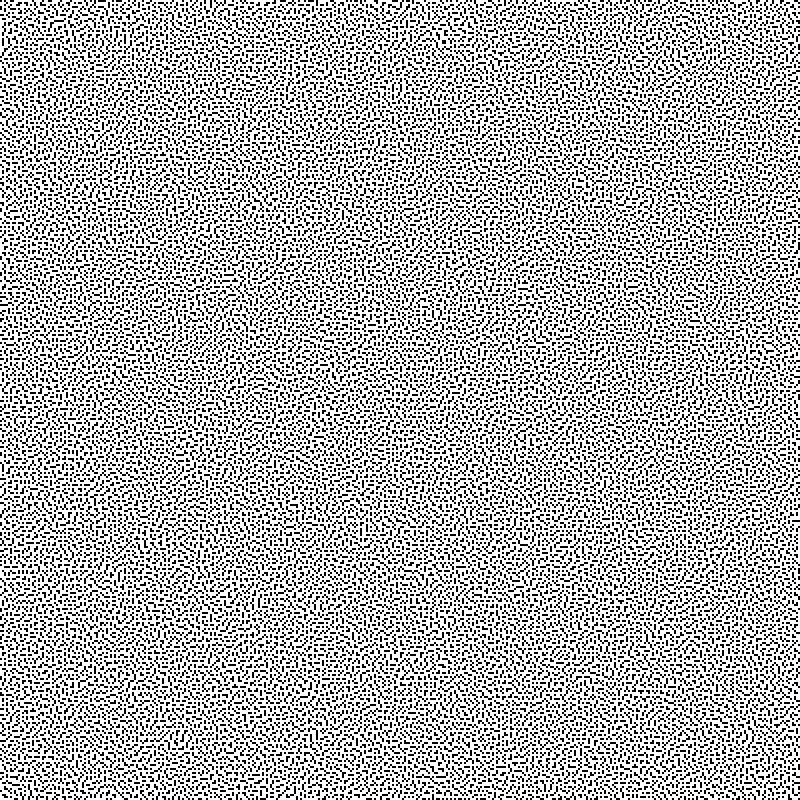
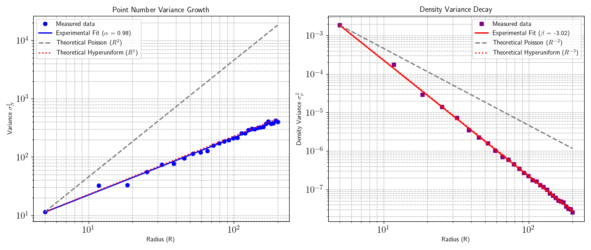

# Hyperuniform2D

**Version 2.0.0** — see [CHANGELOG.md](CHANGELOG.md).

Generator for hyperuniform points in a 2D square grid

This repository contains a C++20 program that generates **binary hyperuniform distributions** on an $`N \times N`$ square lattice. The optimization is carried out via **Metropolis simulated annealing**, minimizing an energy based on the structure factor $`S(\mathbf{k})`$.

The output is a configuration of occupied/empty sites that suppresses large-scale density fluctuations — a fundamental property of disordered systems with hidden order, relevant in photonics, granular materials, and biology.

## Requirements

To build and run the simulation, you will need:
- A **C++20** compatible compiler (e.g., GCC 10+, Clang 10+, MSVC 19.29+)
- **CMake** 3.20 or newer

## Compilation

The project uses CMake as its build system. It is highly recommended to compile in `Release` mode to ensure maximum performance during the simulated annealing process.

```bash
# Generate build files
cmake -S . -B build -DCMAKE_BUILD_TYPE=Release

# Compile the project
cmake --build build --parallel
```

## Usage

After compilation, the executable `hyper2D` will be located in the `build/` directory. The program takes a single optional argument: the path to the parameter configuration file. If no argument is provided, it defaults to `params.in`.

```bash
./build/hyper2D params.in
```

Unit tests (energy against a direct trigonometric evaluation, incremental updates, thread pool, χ, S(k) sum rule, parameter parsing):

```bash
ctest --test-dir build --output-on-failure
```

On a cluster, `-march=native` optimizes for the CPU of the machine that compiles. Either compile on a compute node or configure with `-DHYPER2D_NATIVE=OFF`.

### Configuration File (`params.in`)

The parameter file uses a simple `key: value` format. Lines starting with `#` are considered comments. 

A `#` also starts a trailing comment. A value that cannot be parsed, or one out of range, stops the program with a message that names the line.

Example, with the mask set by the stealthiness χ:
```yaml
# Grid size
N: 120
# Occupation fraction
density: 0.3
# Stealthiness chi (the mask radius K is derived from it); 0 = use K instead
chi: 0.3
# Simulated annealing parameters (T_initial <= 0: automatic)
T_initial: 0
T_final: 0.001
cooling_rate: 0.98
steps_per_temp: 3000
quench_steps: 100000
# Random seed
seed: 1729
# Number of threads (0 = auto, 1 = sequential)
num_threads: 1
# Output files
output_file: hyperuniform.pgm
annealing_file: annealing.dat
sk_file: sk.dat
```

On this machine (Ryzen 5 5600X), that example runs in about 10 s. It reaches $`\langle S\rangle_{\mathrm{mask}}/(1-\rho) = 0.017`$, i.e. $`S(k) \approx 0.012`$ for every $`0<|k|\le K = 28.7`$, against $`1-\rho = 0.7`$ for a random pattern.

### Stealthiness χ

The number of constrained wave vectors is controlled by the **stealthiness** parameter of Torquato and coworkers (Batten, Stillinger & Torquato 2008; Zhang, Stillinger & Torquato 2015):

```math
\chi = \frac{M_K}{d\,(n-1)} = \frac{M_K}{2\,(n-1)},
```

where $`M_K`$ is the number of independently constrained wave vectors with $`0<|\mathbf k|\le K`$. Because $`\hat\rho(-\mathbf k) = \hat\rho(\mathbf k)^*`$, each $`\pm\mathbf k`$ pair counts once, so $`M_K`$ is the number of half-plane modes in the mask. $`n`$ is the number of points. On the lattice, the empty sites have the same $`|\hat\rho(\mathbf k)|`$ as the occupied ones for $`\mathbf k \neq 0`$, so the program uses the minority species, $`n = \min(M, N^2-M)`$. χ is the ratio of independent real constraints ($`2M_K`$) to real degrees of freedom ($`d(n-1)`$). For $`\chi<1/2`$, stealthy ground states are disordered, and they become more ordered as χ grows. For $`\chi>1/2`$ they crystallize, and the program warns.

With `chi > 0`, the program picks the integer $`K^2`$ whose χ is closest to the target. All the modes of a shell $`k_x^2+k_y^2 = \text{const}`$ enter together, so the achieved χ is discrete and is printed and recorded in the PGM header. With `chi: 0` (the default), the mask is set by `K` as before, and the program still reports the resulting χ. If both are given, `chi` wins and the program warns.

On a lattice the annealing does not reach $`E = 0`$ exactly for χ ≈ 0.2–0.3. The program therefore reports the residual $`\langle S\rangle_{\mathrm{mask}}/(1-\rho)`$: 1 for the random start, 0 for a perfectly stealthy pattern. It is typically 1–2 % at χ = 0.3.


### Multithreading

A thread pool splits the modes of each swap proposal among threads. The calling thread does one share, and the pool synchronizes with spinning barriers. A proposal lasts only microseconds, so the futex wake-up of `std::barrier` (tens of µs) cost more than the work it parallelized.

- `num_threads: 0` uses min(4, CPUs this process may run on). The CPU count comes from the affinity mask, i.e. the Slurm allocation, not every core of the node. Gains saturate around 2–4 threads (table below).
- `num_threads: 1` runs sequentially.
- With fewer than `parallel_min_modes` half-plane modes (default 2000), the program runs sequentially anyway.

Spinning keeps every pool thread busy for the whole run. Never request more threads than allocated cores. To produce many maps, running one sequential process per map (e.g. a Slurm array) is more efficient than threading a single map. Measured on a Ryzen 5 5600X (6 cores, 12 hardware threads), in µs per proposal at low acceptance:

| N | half-plane modes | 1 thread | 2 | 4 | 8 |
|---|---|---|---|---|---|
| 120 | 1 728 | 2.0 | 2.4 | 1.5 | 1.6 |
| 240 | 6 912 | 17 | 8.4 | 5.7 | 4.5 |
| 400 | 19 196 | 57 | 21 | 17 | 21 |

### Output Files

The simulation generates three main output files (names can be configured in `params.in`):

1. **`hyperuniform.pgm`**: The final spatial configuration saved as a plain PGM (Portable GrayMap) image. The values represent grid occupation (0 or 1). Comment lines after the magic number record N, density, K, χ (achieved and target), seed, initial and final energy and the residual; PGM readers skip them.
2. **`annealing.dat`**: one line per temperature level: temperature `T`, energy `E`, cumulative acceptance rate `acc/rate` and acceptance rate of that level `acc/level`. Every proposal is a genuine occupied ↔ empty swap. Use it to tune the cooling schedule.
3. **`sk.dat`**: radially averaged structure factor $`S(k) = |\hat\rho(\mathbf k)|^2/M`$ over the whole Brillouin zone ($`\mathbf k \ne 0`$, bins of width 1 in units of $`2\pi/N`$). Columns: mean $`|k|`$ of the bin, $`S(k)`$ and number of modes. For an uncorrelated lattice gas $`S = 1-\rho`$.

#### Note 

The PGM image is stored in plain text format (magic number P2). Occupied sites (1) are shown as white pixels, and empty sites (0) as black pixels. If you prefer the opposite coloring (black for occupied, white for empty), you can invert the image using ImageMagick:

    magick input.pgm -negate -compress none output.pgm

The `-compress none` option keeps the output in human‑readable PGM text format.

### Output image sample 

$`400 \times 400`$, density = $`0.2`$



## Hyperuniformity Analysis Tool

This Python script evaluates whether a 2D point distribution exhibits **hyperuniformity**. The distribution is read from the occupied sites (pixel = max value) of a text-based PGM image (P2 format). The script computes, with periodic boundary conditions, how the number variance $`\sigma_N^2`$ of the count in a disk scales with the radius $`R`$. It uses all $`N^2`$ lattice centres: the count is a periodic FFT convolution of the occupation with the disk, so it is exact, with no sampling noise. It also computes the radially averaged $`S(k)`$. $`\sigma_\rho^2 = \sigma_N^2/(\pi R^2)^2`$ is plotted too, but its exponent is $`\alpha - 4`$ by definition, so it is not an independent test. The fit range defaults to $`5 \le R \le N/4`$. Near $`R = N/2`$, the fixed total number of particles suppresses the variance artificially. 

In standard Poisson (uncorrelated random) systems, number variance grows with the window area ($`\sigma_N^2 \sim R^2`$) while density fluctuations decay as $`\sigma_\rho^2 \sim R^{-2}`$. In contrast, hyperuniform systems suppress large-scale density fluctuations, which reflects in a significantly slower growth of number variance ($`\sigma_N^2 \sim R`$) and a faster decay of density variance ($`\sigma_\rho^2 \sim R^{-3}`$). The script automatically detects the image boundaries, performs a log-log linear regression to extract the experimental exponents, and plots them alongside theoretical baselines for a clear quantitative verdict.

### Usage

To analyze a PGM image generated by your simulation code, run the script from the command line by passing the file path as an argument:

```bash
python3 test_hyper2D.py path/to/your_image.pgm
```

Options: `--rmin`, `--rmax`, `--n-radii`, `--save fig.pdf`, `--no-show`. The original random-window estimator is still available, now with a fixed seed:

```bash
python3 test_hyper2D.py path/to/your_image.pgm --method sample --samples 5000
``` 

### Output analysis sample

For the $`120 \times 120`$, density 0.3, χ = 0.3 example above:

```bash
Reading file: hyperuniform.pgm...
Image: 120x120, 4320 occupied sites, density 0.3000
Number variance (fft) for R in [5, 30]...

================================================================
                 EXPERIMENTAL FIT RESULTS
================================================================
-> Exponent of var_N (alpha)   : 1.230
   [Poisson = 2 | hyperuniform < 2 (stealthy ~ 1)]
-> Exponent of var_rho (beta)  : -2.770  (= alpha - 4 by definition)
-> <S(k)> for |k| <= 5.1 (2pi/N) : 0.0173   [uncorrelated lattice gas: 1 - rho = 0.7000]
================================================================
```

The figure below was made with the first version of the script ($`400 \times 400`$, density 0.2, random-window estimator).



## License

This project is licensed under the MIT License - see the LICENSE file for details.

## What is a hyperuniform distribution?

A point pattern (or binary occupation) is said to be **hyperuniform** if the variance of the number of particles within an observation window grows more slowly than the window volume as the window size increases. Equivalently, its **structure factor** $`S(\mathbf{k})`$ tends to zero as the wave vector $`\mathbf{k}`$ approaches zero:

```math
\lim_{|\mathbf{k}|\to 0} S(\mathbf{k}) = 0.
```

A perfectly periodic system (like a crystal) has $`S(\mathbf{k})=0`$ away from the Bragg peaks, so a crystal is hyperuniform. However, hyperuniformity can also occur in **disordered** systems, where particles appear randomly distributed but possess long-range correlations that cancel large-scale fluctuations.

This program generates a special type of disordered hyperuniform system known as **“stealthy” hyperuniform**, in which the structure factor is **exactly zero** for all wave vectors with $`|\mathbf{k}| \le K`$, where $`K`$ is a user-defined exclusion radius.

## Mathematical foundation

### System representation

We consider an $`N \times N`$ square lattice with periodic boundary conditions. Each site $`\mathbf{r} = (x, y)`$ can be occupied, $`s(\mathbf r) = 1`$, or empty, $`s(\mathbf r) = 0`$. The occupation fraction is $`\rho = M/N^2`$, where $`M`$ is the total number of occupied sites.

The discrete Fourier transform of the occupation is:

```math
\hat{\rho}(\mathbf{k}) = \sum_{\mathbf{r}} s(\mathbf{r})\, e^{-i \mathbf{k} \cdot \mathbf{r}},
\qquad \mathbf{k} = \frac{2\pi}{N}(k_x, k_y), \quad k_x,k_y \in \mathbb{Z}.
```

The structure factor is defined as 

```math
S(\mathbf{k}) = \frac{1}{M} |\hat{\rho}(\mathbf{k})|^2
```

(normalised by the number of points, the usual convention; an uncorrelated lattice gas has $`S = 1-\rho`$ for $`\mathbf k \ne 0`$).

### Stealthy hyperuniformity condition

To achieve $`S(\mathbf{k}) \to 0`$ as $`\mathbf{k} \to 0`$, we explicitly constrain all modes with $`0 < |\mathbf{k}| \leq K`$ (in units of $`2\pi/N`$). The condition $`S(\mathbf{k}) = 0`$ in that region is equivalent to requiring the Fourier coefficients $`\hat{\rho}(\mathbf{k})`$ to vanish.


### Optimization problem

We define an **energy** that penalizes the presence of Fourier modes within the selected mask:

```math
E = \sum_{\substack{\mathbf{k} \neq \mathbf{0} \\ |\mathbf{k}| \le K}} |\hat{\rho}(\mathbf{k})|^2.
```

A configuration with $`E = 0`$ is perfectly hyperuniform within the suppressed range (up to finite-size effects). Because the search space is discrete and huge, we resort to **simulated annealing** to find near-zero-energy configurations.

Internally only the half plane of $`\mathbf k`$ is stored: $`\hat\rho(-\mathbf k) = \hat\rho(\mathbf k)^*`$. The energy above, which counts both members of each pair, is $`E = 2\sum_{\mathrm{half}}|\hat\rho|^2`$. Temperatures therefore keep their meaning with respect to earlier versions.

## Algorithm

1. **Initialization**: $`M`$ particles are placed randomly on the lattice, respecting the target density.

2. **Mask construction**: All half-plane wave vectors $`\mathbf{k} \neq \mathbf{0}`$ with $`|\mathbf k| \le K`$ (or the $`K`$ that gives the requested χ) are selected, with $`|k_x|, |k_y| < N/2`$. The phase factors are table look-ups, $`e^{-2\pi i (k_x x + k_y y)/N} = w[(k_x x + k_y y) \bmod N]`$, so the annealing loop does no trigonometry.

3. **Initial Fourier transform**: $`\hat{\rho}(\mathbf{k})`$ is evaluated for all modes in the mask.

4. **Simulated annealing**:
   - At each step, a random occupied site and an empty site are chosen from the lists of occupied and empty sites. The empty site is a random one, or, with probability `local_fraction`, a neighbour within Chebyshev distance `local_radius`. An exchange is proposed.
   - The change in energy $`\Delta E`$ is computed using an incremental update of the Fourier coefficients.
   - The swap is accepted according to the Metropolis criterion, $`P_{\text{accept}} = \min\left(1, e^{-\Delta E / T}\right)`$, where $`T`$ is the current temperature.
   - The temperature is gradually reduced by a user-specified cooling factor. The run stops at `T_final`, or earlier if E ≤ `energy_tol`. An optional zero-temperature quench (`quench_steps`) follows. The Fourier sums are recomputed from scratch every `resync_interval` accepted swaps and at the end, so the reported energy is exact.

5. **Result**: After a sufficient number of steps, a binary configuration with near-zero energy is obtained — the long-wavelength modes are suppressed and the system exhibits hyperuniformity.

The program saves the final configuration as a PGM (grayscale) image and writes the radially averaged structure factor to verify mode suppression.

## Parameter file

The simulation is controlled via an external text file. Its format is `key: value`, and lines starting with `#` are treated as comments.

### Available keys

| Key               | Type   | Description                                                                 | Default value       |
|-------------------|--------|-----------------------------------------------------------------------------|---------------------|
| `N`               | integer| Lattice size (N×N)                                                          | 64                  |
| `density`        | real   | Occupation fraction (between 0 and 1)                                       | 0.4                 |
| `K`               | real   | Exclusion radius in units of $`2\pi/N`$ (defines the mask); 1 ≤ K ≤ N/2 − 1; ignored if `chi` > 0 | 4.0 |
| `chi`             | real   | Stealthiness χ; > 0 derives K from it, 0 uses `K`                           | 0                   |
| `T_initial`       | real   | Initial temperature; ≤ 0: automatic (a typical uphill swap from the random start is accepted with probability 1/2) | 10.0 |
| `T_final`         | real   | Final temperature (stopping criterion)                                      | 0.01                |
| `cooling_rate`    | real   | Cooling multiplier (0 < factor < 1)                                         | 0.999               |
| `steps_per_temp`  | integer| Swap proposals (occupied ↔ empty) at each temperature level                 | 1000                |
| `local_fraction`  | real   | Fraction of proposals to a nearby empty site                                | 0.5                 |
| `local_radius`    | integer| "Nearby": Chebyshev distance ≤ `local_radius`                               | 1                   |
| `quench_steps`    | integer| Zero-temperature proposals after the annealing                              | 0                   |
| `energy_tol`      | real   | Stop as soon as E ≤ `energy_tol`                                            | 1e-6                |
| `resync_interval` | integer| Recompute the Fourier sums every so many accepted swaps                     | 1000000             |
| `seed`         | integer| Random seed (for reproducibility), 0 … 2³²−1                                | 1729                  |
| `num_threads`  | integer| Threads: 0 = min(4, CPUs available to the process), 1 = sequential          | 0                |
| `parallel_min_modes` | integer | Fewer half-plane modes than this: sequential                        | 2000             |
| `output_file`  | string | Output PGM file name                                                        | hyperuniform.pgm   |
| `annealing_file`  | string | Annealing algorithm progression                                                        | annealing.dat   |
| `sk_file`  | string | Resulting S(k)                                                         | sk.dat   |

### Version history

Current version: **2.0.0** (`hyper2D --version`). See [CHANGELOG.md](CHANGELOG.md) for the changes with respect to 1.0.0, several of which change outputs and the meaning of `steps_per_temp`.

### References

- Torquato, S., & Stillinger, F. H. (2003). Local density fluctuations, hyperuniformity, and order metrics. Physical Review E, 68(4), 041113. [https://doi.org/10.1103/PhysRevE.68.041113](https://doi.org/10.1103/PhysRevE.68.041113).
- Robert D. Batten, Frank H. Stillinger, Salvatore Torquato; Classical disordered ground states: Super-ideal gases and stealth and equi-luminous materials. J. Appl. Phys. 1 August 2008; 104 (3): 033504. [https://doi.org/10.1063/1.2961314](https://doi.org/10.1063/1.2961314).
- Chase E Zachary and Salvatore Torquato J. Stat. Mech. (2009) P12015. [https://doi.org/10.1088/1742-5468/2009/12/P12015](https://doi.org/10.1088/1742-5468/2009/12/P12015).
- Zhang, G., Stillinger, F. H., & Torquato, S. (2015). Ground states of stealthy hyperuniform potentials: I. Entropically favored configurations. Physical Review E, 92(2), 022119. [https://doi.org/10.1103/PhysRevE.92.022119](https://doi.org/10.1103/PhysRevE.92.022119).
- Kim, J., & Torquato, S. (2019). New tessellation-based procedure to design perfectly hyperuniform disordered dispersions for materials discovery. Acta Materialia, 168, 143-151. [https://doi.org/10.1016/j.actamat.2019.01.026](https://doi.org/10.1016/j.actamat.2019.01.026).
