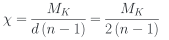
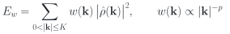
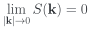
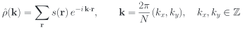
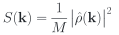
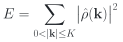

# Hyperuniform2D

**Version 2.1.0** — see [CHANGELOG.md](CHANGELOG.md).

Generator for hyperuniform points in a 2D square grid

This repository contains a C++20 program that generates **stealthy hyperuniform binary patterns** on an *N* × *N* square lattice with periodic boundaries. The patterns are obtained by **Metropolis simulated annealing** of an energy built from the structure factor *S*(**k**).

The output is a configuration of occupied and empty sites that suppresses large-scale density fluctuations. That is the defining property of disordered systems with hidden order, relevant in photonics, granular materials and biology.

<p align="center">
  
  
</p>
<p align="center"><em>Left: the 400 × 400 pattern produced by the example <code>params.in</code> (density 0.3, χ = 0.3, <code>weight_power: 2</code>); occupied sites in black. Right: its top-left 100 × 100 corner, enlarged.</em></p>

## Requirements

- A **C++20** compiler (e.g. GCC 11+, Clang 14+, MSVC 19.29+)
- **CMake** 3.20 or newer
- For the analysis script: Python 3 with NumPy and Matplotlib (LaTeX is used for the labels if it is installed)

## Compilation

Compile in `Release` mode for full speed:

```bash
cmake -S . -B build -DCMAKE_BUILD_TYPE=Release
cmake --build build --parallel
```

Unit tests:

```bash
ctest --test-dir build --output-on-failure
```

They cover:
- the energy against a direct trigonometric evaluation;
- incremental updates and weighted energies;
- the thread pool and threaded determinism;
- χ selection;
- the Parseval sum rule of *S*(*k*);
- parameter parsing.

On a cluster, `-march=native` optimizes for the CPU of the machine that compiles. Either compile on a compute node or configure with `-DHYPER2D_NATIVE=OFF`.

## Quick start

The repository's `params.in` is a complete, commented example: a 400 × 400 lattice, density 0.3, χ = 0.3, with the long wavelengths weighted.

```bash
./build/hyper2D params.in                          # writes hyperuniform.pgm, annealing.dat, sk.dat
python3 scripts/test_hyper2D.py hyperuniform.pgm   # hyperuniformity check
```

The program takes one optional argument, the parameter file (default `params.in`). `hyper2D --version` prints the version.

The run makes about 14 million swap proposals and takes about 3 minutes on a Ryzen 5 5600X with 4 threads. The end of its output reads:

```text
Mask: K = 95.7183 (K² = 9162), chi = 0.299923 (target 0.3)
Initialized thread pool with 4 threads.
Automatic T_initial = 1.26998e+06
Starting simulated annealing → 'annealing.dat'
Annealing finished: 689 levels, 14180000 proposals, acceptance 0.2021. Monitoring saved to 'annealing.dat'
Initial energy: 9.65689e+08
Weighted energy (w ∝ |k|^-2): 9.10471e+08 -> 3.50694e+06
Final energy: 1.70076e+07, max incremental drift 3.44e-05
Residual <S>_mask / (1 - rho) = 0.01758 (1 = random start, 0 = perfectly stealthy)
Residual of the longest wavelengths, |k| <= K/4 = 23.93: 0.001085
Configuration saved to 'hyperuniform.pgm'
Structure factor saved to 'sk.dat'
```

The residual 0.018 means that *S*(**k**) inside the mask is 1.8 % of its value for an uncorrelated pattern. For the longest wavelengths it is 0.1 %. Both quantities are explained below.

### The example parameter file

```yaml
# hyper2D 2.x parameter file: "key: value", '#' starts a comment.
# Run:      ./build/hyper2D params.in
# Analyse:  python3 scripts/test_hyper2D.py hyperuniform.pgm
#
# Stealthy hyperuniform pattern on a 400 x 400 periodic lattice, density 0.3, chi = 0.3,
# with the long wavelengths weighted (weight_power: 2). Measured with these values (Ryzen 5 5600X):
# about 14 million proposals, a few minutes with 4 threads; residual <S>_mask/(1-rho) ~ 0.018,
# residual for |k| <= K/4 ~ 0.001, number-variance exponent alpha ~ 0.98.

# --- System ---------------------------------------------------------------------------------
# Lattice side (N x N sites, periodic)
N: 400
# Fraction of occupied sites; the number of occupied sites is round(density * N^2)
density: 0.3

# --- Mask (constrained wave vectors) --------------------------------------------------------
# Stealthiness chi = (constrained half-plane modes) / (n - 1), n = min(occupied, empty).
# chi > 0 derives the mask radius K from it (chi < 0.5 for disordered stealthy patterns).
chi: 0.3
# Mask radius in units of 2pi/N, used instead of chi when chi = 0 (uncomment and set chi: 0)
# K: 4.0

# --- Annealing energy -----------------------------------------------------------------------
# Mode weights w(k) ~ |k|^(-weight_power): 0 = standard unweighted energy; 2 keeps the residual
# away from the longest wavelengths, which control the number variance at large R (recommended)
weight_power: 2

# --- Cooling schedule -----------------------------------------------------------------------
# Initial temperature; <= 0 = automatic (a typical uphill swap is accepted with probability 1/2)
T_initial: 0
# Final temperature: the annealing stops below it
T_final: 0.001
# Geometric cooling factor per temperature level
cooling_rate: 0.97
# Swap proposals (occupied <-> empty) per temperature level
steps_per_temp: 20000
# Fraction of proposals that move a point to a nearby empty site, and "nearby" (Chebyshev distance)
local_fraction: 0.5
local_radius: 1
# Zero-temperature proposals after the annealing (only downhill swaps)
quench_steps: 400000
# Stop as soon as the (weighted) energy is below this value
energy_tol: 1e-6

# --- Run ------------------------------------------------------------------------------------
# Random seed (0 ... 2^32 - 1)
seed: 1729
# Threads: 0 = automatic (min(4, CPUs available to the process)), 1 = sequential
num_threads: 0

# --- Output files ---------------------------------------------------------------------------
# Pattern (plain PGM, 1 = occupied; the header comments record the parameters and residuals)
output_file: hyperuniform.pgm
# Per temperature level: T, energy, cumulative and per-level acceptance
annealing_file: annealing.dat
# Radially averaged structure factor S(k) = |rho_hat(k)|^2 / M
sk_file: sk.dat
```

A value that cannot be parsed, or one out of range, stops the program with a message that names the line. All the keys are listed in [Parameter file](#parameter-file).

## Stealthiness χ

The number of constrained wave vectors is set by the **stealthiness** parameter of Torquato and coworkers (Batten, Stillinger & Torquato 2008; Zhang, Stillinger & Torquato 2015):

<p align="center"><picture>
  <source media="(prefers-color-scheme: dark)" srcset="docs/eq/chi_dark.svg">
  
</picture></p>

- *M*<sub>*K*</sub> is the number of independently constrained wave vectors with 0 < |**k**| ≤ *K*.
- Because ρ̂(−**k**) = ρ̂(**k**)\*, each ±**k** pair counts once, so *M*<sub>*K*</sub> is the number of half-plane modes in the mask.
- *n* is the number of points. On the lattice, the empty sites have the same |ρ̂(**k**)| as the occupied ones for **k** ≠ 0, so the program uses the minority species, *n* = min(*M*, *N*² − *M*).
- χ is the ratio of independent real constraints (2*M*<sub>*K*</sub>) to real degrees of freedom (*d*(*n* − 1)).

For χ < 1/2, stealthy ground states are disordered, and they become more ordered as χ grows. For χ > 1/2 they crystallize, and the program warns.

With `chi > 0`, the program picks the integer *K*² whose χ is closest to the target. All the modes of a shell *k*<sub>*x*</sub>² + *k*<sub>*y*</sub>² = const enter together, so the achieved χ is discrete; it is printed and recorded in the PGM header. With `chi: 0` (the default), the mask is set by `K`, and the program still reports the resulting χ. If both are given, `chi` wins and the program warns.

On a lattice the annealing does not reach *E* = 0 exactly for χ ≈ 0.2–0.4. The program therefore reports the residual ⟨*S*⟩<sub>mask</sub> / (1 − ρ): 1 for the random start, 0 for a perfectly stealthy pattern. It is typically 1–2 % at χ = 0.3.

## Weighting the long wavelengths (`weight_power`)

That residual is not uniform.
- **Few modes.** All modes weigh the same in *E*, and the lowest |**k**| are a small fraction of them.
- **Local moves barely touch them.** Moving a point a distance δ changes ρ̂(**k**) by an amount proportional to |**k**·**δ**|.

The annealing therefore leaves most of the residual at the longest wavelengths. Those are the modes that control the number variance at large *R*: a residual *S*<sub>0</sub> adds about ρ *S*<sub>0</sub> π *R*² to σ<sub>*N*</sub>², and the fitted exponent drifts towards 2. The effect grows with *N*.

With `weight_power: p` the annealing minimises

<p align="center"><picture>
  <source media="(prefers-color-scheme: dark)" srcset="docs/eq/weighted_energy_dark.svg">
  
</picture></p>

- **Normalisation.** The weights have mean 1 over the mask, so the temperature scale is unchanged.
- **Same target.** All weights are positive, so *E*<sub>*w*</sub> = 0 exactly when *E* = 0: the target, perfectly stealthy patterns, is the same. Only the unavoidable residual is pushed towards large |**k**|, where it hardly affects σ<sub>*N*</sub>².
- **Reported values.** The program prints the unweighted *E*, the mask average of the residual, and the residual of the longest wavelengths, |**k**| ≤ *K*/4.

Measured with ρ = 0.3, χ = 0.3, automatic initial temperature and the same schedule for each *N*:

| N | p | residual, mask | residual, \|k\| ≤ K/4 | α (5 ≤ R ≤ N/4) |
|---|---|---|---|---|
| 120 | 0 | 0.017–0.018 | 0.024–0.034 | 1.23–1.57 |
| 120 | 1 | 0.015 | 0.005–0.006 | 1.04 |
| 120 | **2** | 0.017 | 0.0009–0.0013 | **0.97–0.98** |
| 120 | 3 | 0.027 | 0.0002–0.0004 | 0.98–0.99 |
| 400 | 0 | 0.018 | 0.037 | 1.69 |
| 400 | **2** | 0.018 | 0.0011 | **0.98** |

The *N* = 120 rows cover two seeds. `weight_power: 2` is recommended. With p = 3 the low-k modes are even cleaner, but the mask average gets worse. The default, 0, is the standard unweighted energy.

## Multithreading

A thread pool splits the modes of each swap proposal among threads. The calling thread does one share, and the pool synchronizes with spinning barriers. A proposal lasts only microseconds, so the futex wake-up of `std::barrier` (tens of µs) cost more than the work it parallelized.

- `num_threads: 0` uses min(4, CPUs this process may run on). The CPU count comes from the affinity mask, i.e. the Slurm allocation, not every core of the node.
- `num_threads: 1` runs sequentially.
- With fewer than `parallel_min_modes` half-plane modes (default 2000), the program runs sequentially anyway.

Spinning keeps every pool thread busy for the whole run, so never request more threads than allocated cores. To produce many maps, one sequential process per map (e.g. a Slurm array) is more efficient than threading a single map.

Measured on a Ryzen 5 5600X (6 cores, 12 hardware threads), in µs per proposal at low acceptance:

| N | half-plane modes | 1 thread | 2 | 4 | 8 |
|---|---|---|---|---|---|
| 120 | 1 728 | 2.0 | 2.4 | 1.5 | 1.6 |
| 240 | 6 912 | 17 | 8.4 | 5.7 | 4.5 |
| 400 | 19 196 | 57 | 21 | 17 | 21 |

## Output files

The file names are set in the parameter file.

1. **`hyperuniform.pgm`**: the final configuration as a plain-text PGM image (P2), with 1 = occupied and 0 = empty.
   - Comment lines after the magic number record the version, *N*, density, *K*, χ (achieved and target), seed, energies, residuals and `weight_power`. PGM readers skip them.
   - Image viewers show the occupied sites in white. To draw them in black, invert the image: `magick input.pgm -negate -compress none output.pgm`. The analysis script still recognises the occupied sites of an inverted file, from the count recorded in the header.
2. **`annealing.dat`**: one line per temperature level, with temperature `T`, energy (`E`, or `E_w` with weights), cumulative acceptance rate `acc/rate` and the acceptance rate of that level `acc/level`. Every proposal is a genuine occupied ↔ empty swap. Use it to tune the cooling schedule.
3. **`sk.dat`**: radially averaged structure factor *S*(*k*) = |ρ̂(**k**)|² / *M* over the whole Brillouin zone (**k** ≠ 0, bins of width 1 in units of 2π/*N*).
   - Columns: mean |*k*| of the bin, *S*(*k*) and number of modes.
   - For an uncorrelated lattice gas, *S* = 1 − ρ.

## Hyperuniformity analysis tool

`scripts/test_hyper2D.py` reads a plain PGM (P2) image and analyses its occupied sites.

1. **Number variance.** It computes σ<sub>*N*</sub>² of the count in a disk of radius *R* over all *N*² lattice centres, with periodic boundaries. The counts come from a periodic FFT convolution, so they are exact, with no sampling noise.
2. **Exponent.** It fits the exponent α of σ<sub>*N*</sub>² ∼ *R*<sup>α</sup>, by default on 5 ≤ *R* ≤ *N*/4. Near *R* = *N*/2 the fixed total number of particles suppresses the variance artificially.
3. **Structure factor.** It computes the radially averaged *S*(*k*).

| Pattern | Number variance | Density variance |
|---|---|---|
| Uncorrelated (Poisson-like) | σ<sub>*N*</sub>² ∼ *R*² | σ<sub>ρ</sub>² ∼ *R*<sup>−2</sup> |
| Stealthy hyperuniform | σ<sub>*N*</sub>² ∼ *R* | σ<sub>ρ</sub>² ∼ *R*<sup>−3</sup> |

The density variance σ<sub>ρ</sub>² = σ<sub>*N*</sub>² / (π*R*²)² is plotted too. Its exponent is α − 4 by definition, so it is not an independent test.

```bash
python3 scripts/test_hyper2D.py hyperuniform.pgm
```

Options:
- `--rmin`, `--rmax`, `--n-radii`: fit range;
- `--save fig.png`, `--no-show`: figure output;
- `--species {auto,max,min}`: which pixel value is occupied. The default, `auto`, reads it from the hyper2D header.
- `--method sample --samples 5000`: the original random-window estimator, with a fixed seed (`--seed`).

Output for the example map:

```text
Reading file: hyperuniform.pgm...
Image: 400x400, 48000 occupied sites, density 0.3000
Number variance (fft) for R in [5, 100]...

================================================================
                 EXPERIMENTAL FIT RESULTS
================================================================
-> Exponent of var_N (alpha)   : 0.984
   [Poisson = 2 | hyperuniform < 2 (stealthy ~ 1)]
-> Exponent of var_rho (beta)  : -3.016  (= alpha - 4 by definition)
-> <S(k)> for |k| <= 19.1 (2pi/N) : 0.0003424   [uncorrelated lattice gas: 1 - rho = 0.7000]
================================================================
```


From left to right:
1. **Number variance.** σ<sub>*N*</sub>² grows as *R*<sup>0.98</sup>, compared with the Poisson *R*² and the stealthy *R*.
2. **Density variance.** σ<sub>ρ</sub>² decays as *R*<sup>−3.02</sup>.
3. **Structure factor.** *S*(*k*) is essentially zero up to the mask radius *K* = 95.7 and jumps to the uncorrelated level beyond it.

## What is a hyperuniform distribution?

A point pattern (or binary occupation) is **hyperuniform** if the variance of the number of particles in an observation window grows more slowly than the window volume as the window grows. Equivalently, its **structure factor** vanishes at long wavelengths:

<p align="center"><picture>
  <source media="(prefers-color-scheme: dark)" srcset="docs/eq/hyperuniform_dark.svg">
  
</picture></p>

A crystal has *S*(**k**) = 0 away from its Bragg peaks, so it is hyperuniform. Hyperuniformity also occurs in **disordered** systems, where particles look randomly placed but long-range correlations cancel the large-scale fluctuations.

This program generates **stealthy** hyperuniform patterns, in which *S*(**k**) is zero (ideally exactly, on a lattice up to a small residual) for all wave vectors with 0 < |**k**| ≤ *K*.

## Mathematical foundation

### System representation

Consider an *N* × *N* square lattice with periodic boundary conditions. Each site **r** = (*x*, *y*) is occupied, *s*(**r**) = 1, or empty, *s*(**r**) = 0. The occupation fraction is ρ = *M* / *N*², where *M* is the number of occupied sites.

The discrete Fourier transform of the occupation is

<p align="center"><picture>
  <source media="(prefers-color-scheme: dark)" srcset="docs/eq/fourier_dark.svg">
  
</picture></p>

and the structure factor is

<p align="center"><picture>
  <source media="(prefers-color-scheme: dark)" srcset="docs/eq/structure_factor_dark.svg">
  
</picture></p>

normalised by the number of points (the usual convention). An uncorrelated lattice gas has *S* = 1 − ρ for **k** ≠ 0.

### Stealthy hyperuniformity condition

All modes with 0 < |**k**| ≤ *K* (in units of 2π/*N*) are constrained. *S*(**k**) = 0 there is equivalent to ρ̂(**k**) = 0.

### Optimization problem

The **energy** penalizes the Fourier modes inside the mask:

<p align="center"><picture>
  <source media="(prefers-color-scheme: dark)" srcset="docs/eq/energy_dark.svg">
  
</picture></p>

A configuration with *E* = 0 is perfectly stealthy within the mask. The search space is discrete and huge, so **simulated annealing** is used to find configurations of near-zero energy.

Internally only the half plane of **k** is stored, because ρ̂(−**k**) = ρ̂(**k**)\*. The energy above counts both members of each pair: *E* = 2 Σ<sub>half</sub> |ρ̂|².

## Algorithm

1. **Initialization**: *M* = round(ρ *N*²) particles are placed at random.
2. **Mask construction**:
   - All half-plane wave vectors with 0 < |**k**| ≤ *K* are selected, with |*k*<sub>*x*</sub>|, |*k*<sub>*y*</sub>| < *N*/2. *K* is either given or derived from χ.
   - The phase factors are table look-ups, exp(−2π*i*(*k*<sub>*x*</sub>*x* + *k*<sub>*y*</sub>*y*)/*N*) = *w*[(*k*<sub>*x*</sub>*x* + *k*<sub>*y*</sub>*y*) mod *N*], so the annealing loop does no trigonometry.
3. **Initial Fourier transform**: ρ̂(**k**) is evaluated for all modes in the mask.
4. **Simulated annealing**:
   - **Proposal.** Each step takes a random occupied site and an empty site, both drawn from the lists of occupied and empty sites. The empty site is a random one or, with probability `local_fraction`, a neighbour within Chebyshev distance `local_radius`.
   - **Energy change.** The change Δ*E* (of *E*<sub>*w*</sub> with weights) comes from an incremental update of the Fourier sums.
   - **Acceptance.** The swap is accepted with the Metropolis probability min(1, exp(−Δ*E* / *T*)).
   - **Cooling.** *T* is multiplied by `cooling_rate` after each level. The run stops at `T_final`, or earlier if the energy drops below `energy_tol`.
   - **Quench.** An optional zero-temperature quench (`quench_steps`) follows.
   - **Exact energy.** The Fourier sums are recomputed from scratch every `resync_interval` accepted swaps and at the end, so the reported energy is exact.
5. **Result**: the configuration, the radially averaged structure factor and the residuals are written to disk.

## Parameter file

The simulation is controlled by a text file in `key: value` format. `#` starts a comment, also at the end of a line.

| Key | Type | Description | Default |
|---|---|---|---|
| `N` | integer | Lattice side (*N* × *N*) | 64 |
| `density` | real | Occupation fraction, in (0, 1) | 0.4 |
| `chi` | real | Stealthiness χ; > 0 derives *K* from it, 0 uses `K` | 0 |
| `K` | real | Mask radius in units of 2π/*N*, 1 ≤ *K* ≤ *N*/2 − 1; ignored if `chi` > 0 | 4.0 |
| `weight_power` | real | p in the mode weights *w* ∝ \|**k**\|<sup>−p</sup> of the annealing energy, 0 ≤ p ≤ 8; 0 = unweighted (2 recommended) | 0 |
| `T_initial` | real | Initial temperature; ≤ 0: automatic (a typical uphill swap from the random start is accepted with probability 1/2) | 10.0 |
| `T_final` | real | Final temperature (stopping criterion) | 0.01 |
| `cooling_rate` | real | Cooling factor per level, in (0, 1) | 0.999 |
| `steps_per_temp` | integer | Swap proposals (occupied ↔ empty) per temperature level | 1000 |
| `local_fraction` | real | Fraction of proposals to a nearby empty site | 0.5 |
| `local_radius` | integer | "Nearby": Chebyshev distance ≤ `local_radius` | 1 |
| `quench_steps` | integer | Zero-temperature proposals after the annealing | 0 |
| `energy_tol` | real | Stop as soon as the (weighted) energy ≤ `energy_tol` | 1e-6 |
| `resync_interval` | integer | Recompute the Fourier sums every so many accepted swaps | 1000000 |
| `seed` | integer | Random seed, 0 … 2³² − 1 | 1729 |
| `num_threads` | integer | Threads: 0 = min(4, CPUs available to the process), 1 = sequential | 0 |
| `parallel_min_modes` | integer | Fewer half-plane modes than this: sequential | 2000 |
| `output_file` | string | Output PGM file | hyperuniform.pgm |
| `annealing_file` | string | Annealing monitor | annealing.dat |
| `sk_file` | string | Radially averaged *S*(*k*) | sk.dat |

The defaults are those of a program run without a parameter file. The example `params.in` sets its own values.

## Version history

Current version: **2.1.0** (`hyper2D --version`). See [CHANGELOG.md](CHANGELOG.md). Version 2.0.0 changed several outputs and the meaning of `steps_per_temp` with respect to 1.0.0.

## License

This project is licensed under the MIT License — see the [LICENSE](LICENSE) file for details.

## References

- Torquato, S., & Stillinger, F. H. (2003). Local density fluctuations, hyperuniformity, and order metrics. *Physical Review E*, 68(4), 041113. [https://doi.org/10.1103/PhysRevE.68.041113](https://doi.org/10.1103/PhysRevE.68.041113)
- Batten, R. D., Stillinger, F. H., & Torquato, S. (2008). Classical disordered ground states: Super-ideal gases and stealth and equi-luminous materials. *Journal of Applied Physics*, 104(3), 033504. [https://doi.org/10.1063/1.2961314](https://doi.org/10.1063/1.2961314)
- Zachary, C. E., & Torquato, S. (2009). Hyperuniformity in point patterns and two-phase random heterogeneous media. *Journal of Statistical Mechanics: Theory and Experiment*, P12015. [https://doi.org/10.1088/1742-5468/2009/12/P12015](https://doi.org/10.1088/1742-5468/2009/12/P12015)
- Zhang, G., Stillinger, F. H., & Torquato, S. (2015). Ground states of stealthy hyperuniform potentials: I. Entropically favored configurations. *Physical Review E*, 92(2), 022119. [https://doi.org/10.1103/PhysRevE.92.022119](https://doi.org/10.1103/PhysRevE.92.022119)
- Kim, J., & Torquato, S. (2019). New tessellation-based procedure to design perfectly hyperuniform disordered dispersions for materials discovery. *Acta Materialia*, 168, 143–151. [https://doi.org/10.1016/j.actamat.2019.01.026](https://doi.org/10.1016/j.actamat.2019.01.026)
