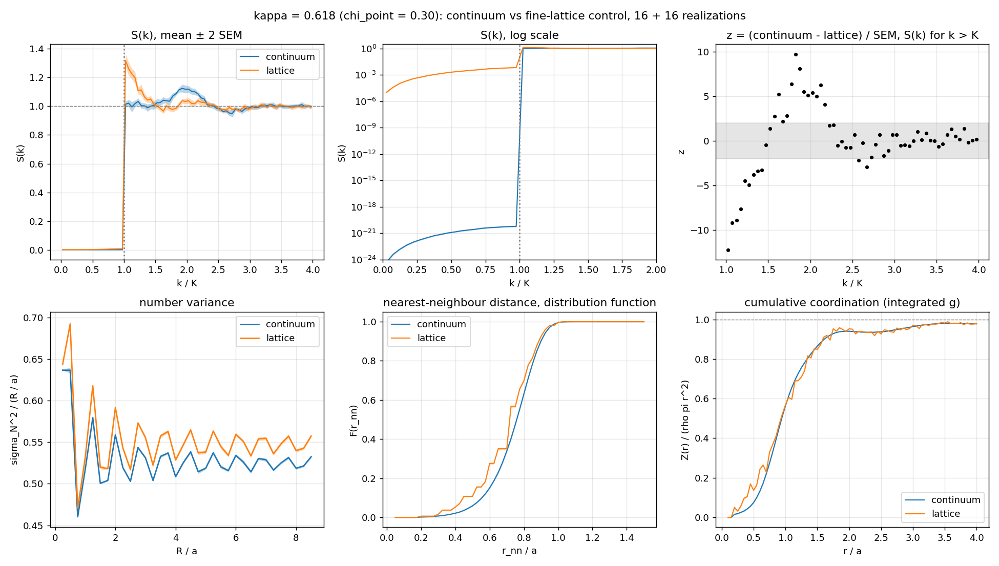
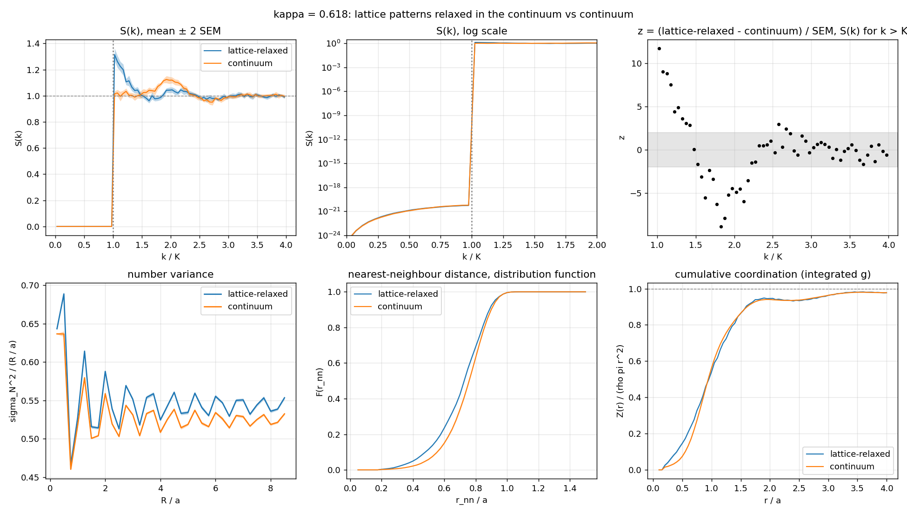
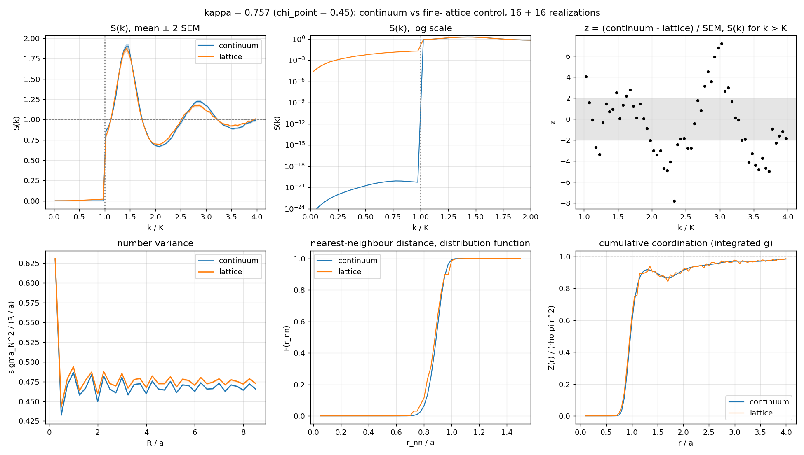

# Validación cruzada red ↔ continuo a igual κ

Fecha: 2026-10-30. Pendiente de M0a de hyperGalton2D (STATUS, sección 2.3, «Next action» 1); sección
«Validación física» de [`PLAN-continuo.md`](PLAN-continuo.md).

- **Generador:** `hyper2D` 2.2.0, commit `f5ffa35`, compilado de cero en `build/` (Release, sin avisos;
  `hyper2D --version` → 2.2.0; `ctest` verde).
- **Análisis:** commit `2e415a6` (`scripts/analyze_obs.py`, `scripts/cross_validate.py`), más
  [`validacion-cruzada/snap_to_lattice.py`](validacion-cruzada/snap_to_lattice.py) para el control de redondeo.
- **Máquina:** Ryzen 5 5600X (6 núcleos, 12 hilos).
- Datos, tablas y archivos de parámetros: [`validacion-cruzada/`](validacion-cruzada/) (`data/<comparación>/`
  con `table.md`, `summary.json`, `curves.json`; `figs/`; `params/` con `gen.sh` y los `.in`). Los `.obs` se
  regeneran bit a bit con esos parámetros (unos 30 min); no se versionan.

## Resumen

| | κ = 0,618 (χ_point = 0,30) | κ = 0,757 (χ_point = 0,45) |
|---|---|---|
| `residual_S` de la red (umbral 0,011) | 0,00392 ± 0,00002 ✅ | **0,01142 ± 0,00003** ❌ (las 16 entre 0,0112 y 0,0116) |
| H = S(0)/S(k_pico), continuo | < 10⁻²⁵ | < 10⁻²⁵ |
| H, red (cota: primer bin, k < 0,05 K) | 2,9·10⁻⁶ (≤ 7,5·10⁻⁶) ✅ | 7,6·10⁻⁶ (≤ 1,3·10⁻⁵) ✅ |
| α (σ²_N ∝ R^α), continuo / red | 0,9957 / 0,9963 | 0,9961 / 0,9961 |
| Λ/φ^½, continuo / red | 0,5929 / 0,6188 (+4,4 %) | 0,5286 / 0,5365 (+1,5 %) |
| S(k_pico) y k_pico/K, continuo | 1,17 en 1,95 | 1,96 en 1,43 |
| S(k_pico) y k_pico/K, red | 1,37 en 1,08 | 1,91 en 1,44 |
| ⟨r_nn⟩/a, continuo / red | 0,739 / 0,703 | 0,886 / 0,880 |
| **Veredicto** | **No coinciden** fuera de la máscara | **Coinciden** salvo por el residuo de la red |

1. **Los dos son hiperuniformes y *stealthy* dentro de lo pedido.** α ≈ 1 en las dos familias, H ≪ 10⁻⁴
   (criterio de Torquato 2018), y *S* → 0 en la máscara: 10⁻²¹ en el continuo, el residuo de la red en la red.
2. **Umbral `residual_S` ≤ 0,011:** se cumple a κ = 0,618 con margen (0,0039), pero a κ = 0,757 la red queda
   en 0,0114, **un 4 % por encima**, en las 16 realizaciones. Es lo que ya había medido el plan (0,0113 con
   ρ = 0,02). El umbral se fijó justo en ese valor; hay que subirlo a 0,012 o bajar la ocupación de la red
   para χ = 0,45 (ρ = 0,01 da 0,0064 según el plan, con el doble de sitios y el mismo costo por propuesta).
3. **χ = 0,45: coinciden.** *S*(*k*) fuera de la máscara, σ²_N y la distancia al primer vecino difieren solo
   por el residuo de la red (Λ +1,5 %, distribución de r_nn más ancha). Al relajar los patrones de red hasta
   *S* = 0 en el continuo, la diferencia baja a 0,2 % en Λ y a ~2σ en el pico de *S*.
4. **χ = 0,30: no coinciden, y no por el residuo.** La red tiene un pico *S* = 1,37 justo afuera de la máscara
   (k ≈ 1,08 K) y más pares cercanos; el continuo tiene *S* ≈ 1 en K⁺ y una joroba de 1,17 en ~2 K. Los
   patrones de red relajados hasta *S* = 0 en el continuo (desplazamiento medio 0,03 a) **conservan** toda la
   estructura de la red. Cada algoritmo cae en una región distinta de la variedad de estados fundamentales,
   que a χ = 0,3 es muy degenerada (dimensión configuracional d(1 − 2χ) = 0,8 por partícula, contra 0,2 a
   χ = 0,45; Torquato, Zhang y Stillinger 2015). El recocido lento en red se parece al ensamble canónico
   T → 0 de ese trabajo (*S* con un pico en k = K que vuelve a 1 en ~2K); L-BFGS desde RSA muestrea otro
   ensamble, como ya anticipaba la síntesis bibliográfica.
5. **Controles del análisis:** red triangular del ejemplo del formato de hyperGalton2D (a = 2),
   Λ/φ^½ = 0,50837 (Torquato y Stillinger 2003: 0,508347); red cuadrada, Λ = 0,45765 con D = a (0,4576) y
   Λ/φ^½ = 0,516404 (0,516401).

## Configuración

Dos familias apareadas por κ (nunca por χ), con la misma caja, densidad y radio:

| | continuo (`examples/continuum.in`) | red de control (`examples/lattice_control.in`) |
|---|---|---|
| caja | 320 × 76,5625 *d* | 320 × 76,5217 *d* (1012 × 242 sitios; *L*ᵧ redondeado a la red) |
| obstáculos, ρ_O | 4900; 0,2 | 4897; 0,199984 |
| *a* = ρ_O^−½ | 2,2361 *d* | 2,2362 *d* |
| *R*, núcleo duro | 0,2; 2*R* = 0,4 *d* = 0,179 *a* | 0,2; exclusión 2*R*/*a*_red = 1,265 sitios |
| red | — | *a*_red = 0,3162 *d* = 0,1414 *a*, ocupación ρ = 0,02 |
| κ = 0,618 | *K* = 1,73632 *d*⁻¹, χ_point = 0,2998 | *K* = 1,73685 *d*⁻¹, χ_binary = 0,5999 |
| κ = 0,757 | *K* = 2,12724 *d*⁻¹, χ_point = 0,4494 | *K* = 2,12761 *d*⁻¹, χ_binary = 0,8993 |
| algoritmo | L-BFGS desde RSA, `weight_power: 2`, `residual_tol: 1e-20` | recocido, `weight_power: 2`, `cooling_rate: 0.97`, `steps_per_temp: 20000`, `quench_steps: 400000` (609 niveles, 1,26·10⁷ propuestas) |
| semillas | 1729–1744 (`realizations: 16`) | 1729–1744 (4 procesos × `realizations: 4`) |
| costo por realización | ~3 s con 6 hilos | ~53 s con 4 hilos (≈ 6,5 min con 4 procesos de 3 hilos en paralelo) |

**Número de realizaciones: 16 por familia y por κ** (64 patrones, ~30 min de máquina). La red domina el costo;
con 16 semillas el error estándar de la media es ~0,1 % en Λ y ~1 % en el pico de *S*, bastante menos que
las diferencias que aparecen, y la prueba nula (abajo) muestra que el criterio de *z* está calibrado. Los
64 `.obs` pasan `scripts/obs_tools.py validate`.

## Método

`scripts/cross_validate.py` analiza cada archivo y promedia sobre las realizaciones, con el error estándar
de la media (SEM) como barra de error. Las dos familias se comparan bin a bin con
*z* = (media₁ − media₂)/√(SEM₁² + SEM₂²), en las unidades que las aparean (*k*/*K*, *r*/*a*):

- *S*(*k*) radial en bines de 0,05 *K* hasta 4 *K*; ⟨*S*⟩_mask normalizado como patrón de puntos y el
  `residual_S` del encabezado (en la red, ⟨*S*⟩/(1 − ρ));
- H = *S*(0)/*S*(*k*_pico), con *S*(0) de un ajuste *S*₀ + *c k*² sobre los modos con |**k**| ≤ *K*/8, y la
  cota superior *S*(primer bin, *k* < 0,05 *K*)/*S*(*k*_pico). En la red, *S* crece más rápido que *k*² dentro de
  la máscara y un ajuste hasta *K*/2 da *S*₀ negativo (4σ); con *K*/8 el ajuste queda consistente con el
  primer bin;
- σ²_N(*R*) espectral, exacta en el toro, en 34 radios de 0,25 *a* a 8,5 *a*; α y Λ/φ^½ = ⟨σ²/*R*⟩·2/√(πρ)
  sobre *R* ≥ *a*;
- distancia al primer vecino: función de distribución *F*(r_nn), media, desviación, mínimo;
- coordinación acumulada *Z*(*r*)/(ρπ*r*²), la integral de *g*(*r*).

Los histogramas de r_nn y de *g*(*r*) **no** se comparan bin a bin: en la red las distancias son
√(*i*² + *j*²)·*a*_red, y con bines de 0,05 *a* o 0,1 *a* aparece un peine que da |*z*| enormes sin contenido
físico. Por eso se usan las funciones acumuladas; aun así, el escalonado de la red deja *z* grandes en *F* y
*Z* donde las curvas se ven superpuestas, así que para esas dos se leen las medias y las figuras, no el conteo
de bines.

**Prueba nula** (continuo contra continuo, semillas 0–7 contra 8–15, κ = 0,618): *S*(*k*) fuera de la máscara
1 de 60 bines con |*z*| > 3 (máx. 4,5) y 5 con |*z*| > 2; σ²_N ninguno con |*z*| > 2; Λ, ⟨r_nn⟩ y el pico de *S*
dentro de 2σ. Con 8 realizaciones por grupo la SEM se subestima un poco (distribución *t*); un bin aislado
con |*z*| ≈ 3–4 no es señal.

## Resultados, κ = 0,618 (χ_point = 0,30)



Tabla completa en [`data/res0618/table.md`](validacion-cruzada/data/res0618/table.md). Lo esencial:

| magnitud | continuo | red | *z* |
|---|---|---|---|
| `residual_S` | 3,2·10⁻²¹ | 0,00392 ± 0,00002 | |
| ⟨*S*⟩ en \|k\| ≤ K/4 | 5,3·10⁻²³ | 2,26·10⁻⁴ | |
| H | 4·10⁻²⁶ | 2,9·10⁻⁶ ± 1,0·10⁻⁶ | |
| *S*(primer bin)/*S*(k_pico) | 4·10⁻²⁵ | 7,5·10⁻⁶ ± 0,8·10⁻⁶ | |
| *S*(k_pico) | 1,170 ± 0,008 | 1,367 ± 0,017 | −10 |
| k_pico/K | 1,95 ± 0,06 | 1,082 ± 0,013 | +14 |
| α | 0,9957 ± 0,0001 | 0,9963 ± 0,0001 | −4 |
| Λ/φ^½ | 0,5929 ± 0,0007 | 0,6188 ± 0,0005 | −30 |
| ⟨r_nn⟩/a | 0,739 ± 0,001 | 0,703 ± 0,001 | +23 |
| desv. r_nn/a | 0,138 ± 0,001 | 0,161 ± 0,000 | −26 |
| P(r_nn < 0,3 a) | 0,0072 ± 0,0004 | 0,0161 ± 0,0005 | −13 |
| *d*_min/a | 0,1789 (= 2*R*) | 0,2000 (√2 sitios) | |

*S*(*k*) fuera de la máscara: 19 de 60 bines con |*z*| > 3, todos entre *K* y 2,3 *K*; de 2,3 *K* en adelante las
dos familias coinciden. σ²_N/*R* de la red queda un 4–5 % arriba en todo el rango, con las mismas
oscilaciones. *Z*(*r*) coincide de 1,5 *a* en adelante; por debajo la red tiene más vecinos cercanos.

### ¿De dónde viene la diferencia?

Dos controles baratos, sobre las mismas 16 realizaciones:

1. **Redondeo** (`snap_to_lattice.py`): cada patrón continuo llevado al sitio más cercano de la red fina de
   1012 × 242. Mide el efecto de la discretización sola. Residuo 0,0125 (tres veces el de la red recocida;
   es el (*K a*_red)²/12 del plan), Λ/φ^½ = 0,6067, pero *S*(*k*) **fuera de la máscara no cambia** (ningún
   bin con |*z*| > 2; pico 1,16 en 1,90 *K*). La discretización no produce el pico en K⁺.
   ([figura](validacion-cruzada/figs/snap0618.png))
2. **Relajación**: cada patrón de red como `init_file` del modo continuo, L-BFGS hasta *S* = 0 (388
   iteraciones, residuo 2,7·10⁻²¹, núcleo duro 2*R*). Los puntos se mueven en promedio 0,029 *a* (rms 0,033 *a*,
   máx. 0,115 *a*), menos de un cuarto de sitio. El resultado coincide con la red fuera de la máscara (ningún
   bin con |*z*| > 2; pico 1,369 en 1,08 *K*) y **difiere del continuo igual que la red** (pico, Λ/φ^½ = 0,6143,
   ⟨r_nn⟩ = 0,704 *a*). ([contra el continuo](validacion-cruzada/figs/relax0618c.png),
   [contra la red](validacion-cruzada/figs/relax0618l.png))



La diferencia de Λ se descompone así: el residuo de la red aporta +0,7 % (red 0,6188 → relajada 0,6143) y el
estado al que llega cada algoritmo +3,6 % (relajada 0,6143 → continuo 0,5929). El pico en K⁺ y el exceso de
vecinos cercanos son del estado, no de la red. Con el control de redondeo se ve además que un residuo de 0,0125
sin reorganización infla Λ un 2,3 %.

## Resultados, κ = 0,757 (χ_point = 0,45)



| magnitud | continuo | red | red relajada | *z* (relajada − continuo) |
|---|---|---|---|---|
| `residual_S` | 4,8·10⁻²¹ | 0,01142 ± 0,00003 | 4,9·10⁻²¹ | |
| H | 0 (ajuste negativo) | 7,6·10⁻⁶ ± 2,1·10⁻⁶ | 2·10⁻²⁶ | |
| *S*(primer bin)/*S*(k_pico) | 1,3·10⁻²⁵ | 1,30·10⁻⁵ ± 0,09·10⁻⁵ | 1,2·10⁻²⁵ | |
| *S*(k_pico) | 1,956 ± 0,015 | 1,909 ± 0,015 | 2,006 ± 0,019 | +2,1 |
| k_pico/K | 1,428 ± 0,011 | 1,441 ± 0,010 | 1,435 ± 0,008 | +0,5 |
| α | 0,9961 | 0,9961 | — | |
| Λ/φ^½ | 0,5286 ± 0,0001 | 0,5365 ± 0,0001 | 0,5277 ± 0,0001 | −5 |
| ⟨r_nn⟩/a | 0,8855 ± 0,0004 | 0,8800 ± 0,0005 | 0,8887 ± 0,0005 | +4,7 |
| desv. r_nn/a | 0,0536 ± 0,0002 | 0,0661 ± 0,0002 | 0,0526 ± 0,0003 | −2,9 |
| *d*_min/a | 0,684 ± 0,005 | 0,607 ± 0,009 | | |

La red y el continuo tienen la misma forma de *S*(*k*) (pico en 1,43–1,44 *K*, segundo máximo en ~2,9 *K*); los
22 bines con |*z*| > 3 son diferencias de 2–4 % en la amplitud de las oscilaciones, que el redondeo reproduce
en buena parte (el continuo redondeado tiene el pico en 1,88 y Λ/φ^½ = 0,5434). Relajada, la red coincide con el continuo en
la máscara y queda a 2 de 60 bines con |*z*| > 3 fuera de ella, Λ a 0,2 %. Lo que queda (≈ 2σ en el pico, ~5σ
en Λ y ⟨r_nn⟩, todos ≤ 0,4 %) puede ser todavía el protocolo, mucho más débil que a χ = 0,3: a χ = 0,45 la
variedad de estados fundamentales tiene poca libertad. Los patrones se mantienen separados por sí solos
(*d*_min = 0,68 *a* en el continuo), como ya había visto el plan.

## Controles del código de análisis

`analyze_obs.py --surface R_MAX` calcula el coeficiente de superficie de σ²_N ≈ Λ *R*/*D* (Torquato y Stillinger
2003) promediado sobre *R*, en la réplica periódica del patrón, donde la fórmula espectral es exacta para
cualquier *R*. Los modos más allá de *k*_max se cierran con *S* = 1 y la suma pasa a integral, que es cerrada:
∫ₓ^∞ *J*₁(*u*)²/*u* d*u* = [*J*₀(*x*)² + *J*₁(*x*)²]/2, de modo que la cola vale π*ρR*²[*J*₀² + *J*₁²](*k*_max *R*).
Λ/φ^½ = ⟨σ²/*R*⟩·2/√(πρ) no depende de *D*.

| red | Λ/φ^½ medido | Torquato y Stillinger (2003) | Λ (D = vecino más próximo) |
|---|---|---|---|
| triangular, `example_obstacles.obs` de hyperGalton2D (a = 2, 8 × 8 celdas, sha256 del archivo `2b6b21f7…`) | 0,508367 | 0,508347 | 0,484125 |
| cuadrada (a = 2, 8 × 8, generada en el test) | 0,516404 | 0,516401 | **0,45765** (0,4576) |

Parámetros: `--kmax 200` (*k*_max *a* = 400), *R* de 2 a 3200 (1600 *a*), 64 000 radios (32 000 en el test).
Λ(*R*) oscila, y el promedio converge lento con el rango: con *R* hasta 200, 400, 800, 1600 y 3200 la
triangular da 0,50864, 0,50846, 0,50836, 0,50832 y 0,50835 (con `--kmax 100`). La cuadrada (*R* hasta 1600 *a*) da
0,51636, 0,51640 y 0,516402 con *k*_max *a* = 100, 200 y 400: hace falta *k*_max *a* ≳ 400. Los dos controles quedan en `ctest`
(`tests/test_analysis.py`, tolerancia 3·10⁻⁵). Salida completa del triangular en
[`data/control_triangular.txt`](validacion-cruzada/data/control_triangular.txt).

Referencia de orden de magnitud (síntesis, Torquato, Zhang y Stillinger 2015, ensamble canónico T → 0): el
coeficiente reescalado vale 0,755 y 0,683 a χ = 0,2 y 0,25, y sigue bajando; nuestros 0,59–0,62 a χ = 0,3 y
0,53 a χ = 0,45 siguen esa tendencia hacia el mínimo de la triangular, 0,508. La comparación directa no
corresponde porque el ensamble es otro.

## Consecuencias para hyperGalton2D

- **El control en red no es un sustituto estadístico del continuo a χ = 0,3**: mismo *K*, mismo ρ_O, ambos
  *stealthy* e hiperuniformes, pero con otro orden de corto alcance (pico de *S* en K⁺, 2,2 veces más obstáculos
  con su vecino a menos de 0,3 *a*, Λ 4 % mayor). En el flujo granular eso importa: la síntesis ata los efectos de
  transporte a los picos de *S*(*k*). Si la campaña usa la red como control, a χ = 0,3 compara **protocolos**,
  no solo «red contra continuo»; conviene declararlo así o elegir un protocolo común (por ejemplo, relajar los
  patrones de red en el continuo, o generar el continuo con recocido).
- A χ = 0,45 el control en red sirve, salvo el umbral: `residual_S` = 0,0114 > 0,011.
- El índice H no discrimina entre las familias: las dos están muy por debajo de 10⁻⁴. Para el control en red,
  `residual_S` es el criterio más exigente.

## Reproducción

```bash
cmake -S . -B build -DCMAKE_BUILD_TYPE=Release && cmake --build build -j
mkdir -p run/xval && cp docs/validacion-cruzada/params/gen.sh run/xval/ && (cd run/xval && ./gen.sh)
cd run/xval
python3 ../../scripts/cross_validate.py --a 'k0618/cont/*.obs' --b 'k0618/lat*/*.obs' \
        --labels continuum lattice --out res0618
python3 ../../docs/validacion-cruzada/snap_to_lattice.py --nx 1012 --ny 242 --out k0618/snap k0618/cont/*.obs
python3 ../../scripts/cross_validate.py --no-validate --a 'k0618/snap/*.obs' --b 'k0618/cont/*.obs' \
        --labels continuum-rounded continuum --out snap0618
```

La relajación usa `examples/continuum.in` sin `Lx`, `Ly` ni `rho_O`, con `init_file:` el `.obs` de red y
`arr_index:` su índice (`params/relax_k0618_arr000.in`); para κ = 0,757 se cambia `kappa`.
